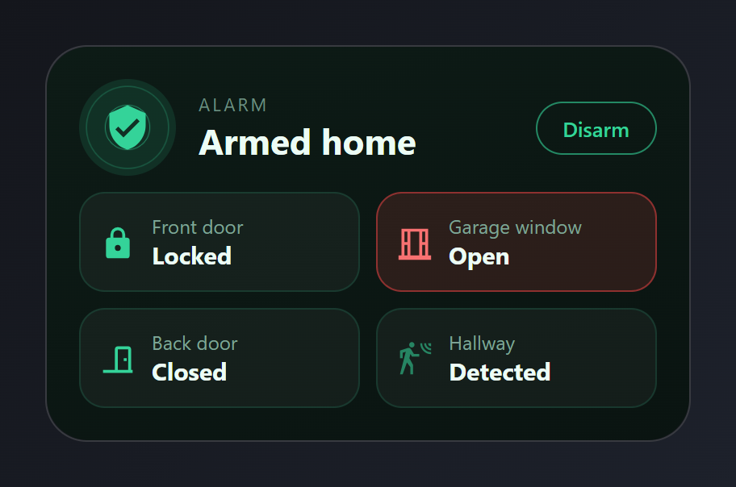
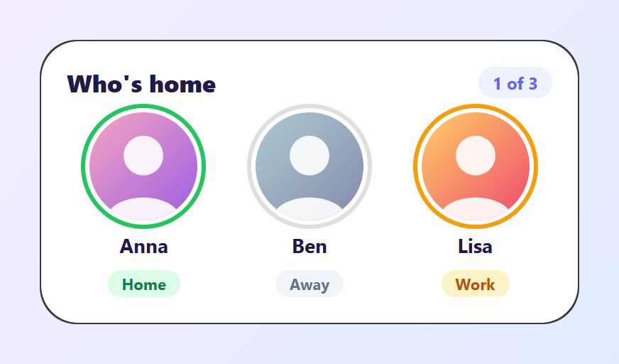
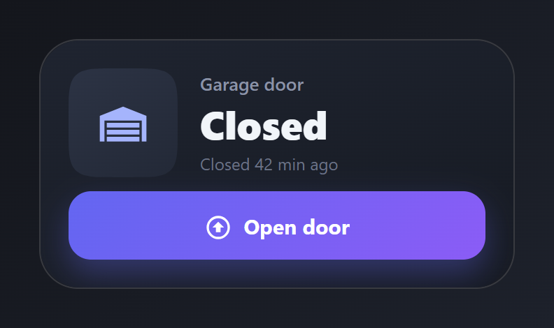
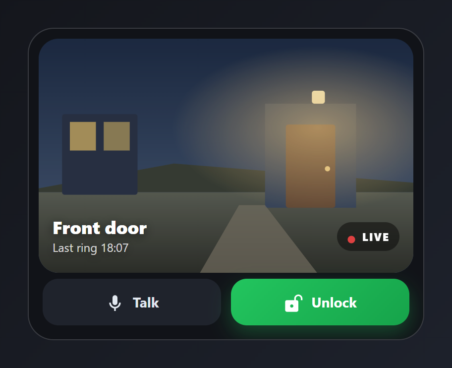
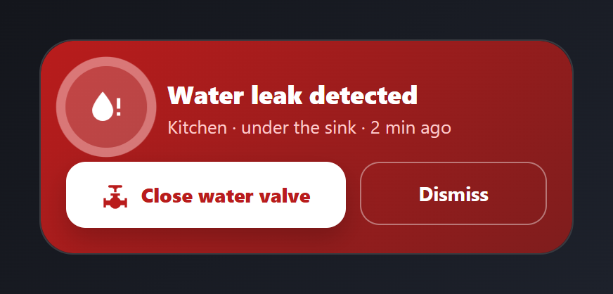
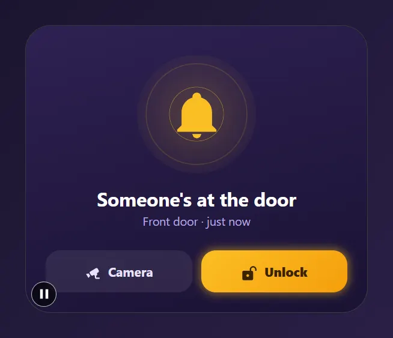
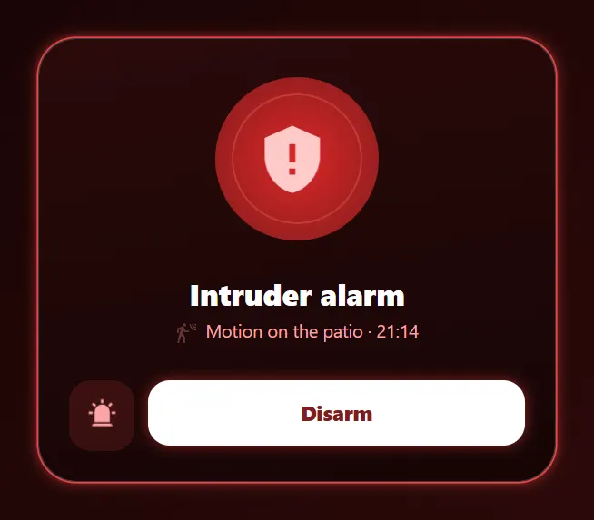

# Security and presence

Alarm, doors, people, the garage, the doorbell and a leak alert. Paste a card into the code editor of a new card, then change the entity ids to your own. Back to the [gallery](README.md).

## Cards

-   [Security](#security)
-   [Who's home](#whos-home)
-   [Garage door](#garage-door)
-   [Doorbell](#doorbell)
-   [Leak alert](#leak-alert)
-   [Ringing doorbell](#ringing-doorbell)
-   [Alarm triggered](#alarm-triggered)

## Security

Alarm state with a rippling shield, and sensor tiles that turn red when a door or window is open or the lock is unlocked.



Entities: `alarm_control_panel.home`, `lock.front_door`, `binary_sensor.back_door`, `binary_sensor.garage_window`, `binary_sensor.hall_motion`

File: [cards/09-security.yaml](cards/09-security.yaml)

```yaml
# Security: alarm state with a rippling shield, and sensor tiles that turn red when
# a door or window is open or the lock is unlocked.
# Entities: alarm_control_panel.home, lock.front_door, binary_sensor.back_door,
#           binary_sensor.garage_window, binary_sensor.hall_motion
type: custom:magic-card
name: Security
background: "linear-gradient(160deg, #0d1b16 0%, #0a1411 100%)"
border_radius: 26px
padding: 20px
box_shadow: "0 18px 40px rgba(0,0,0,0.45)"
rows:
  - id: head
    column_widths: [auto, 1fr, auto]
    gap: 14px
    columns:
      - vertical_align: center
        modules:
          - type: icon
            icon: mdi:shield-check
            size: 30px
            design:
              color: "#34d399"
              width: 60px
              height: 60px
              display: flex
              align_items: center
              justify_content: center
              border_radius: 50%
              background_color: "rgba(52,211,153,0.12)"
              animations:
                - preset: ripple-rings
                  color: "#34d399"
                  duration: 2.6s
      - vertical_align: center
        gap: 0px
        modules:
          - type: text
            text: Alarm
            design: { font_size: 11px, color: "#6b8f80", text_transform: uppercase, letter_spacing: 1.5px }
          - type: text
            use_entity: true
            entity: alarm_control_panel.home
            design: { font_size: 22px, font_weight: "700", color: "#ecfdf5" }
      - vertical_align: center
        modules:
          - type: text
            text: Disarm
            design:
              font_size: 13px
              font_weight: "600"
              color: "#34d399"
              padding: 7px 16px
              border_radius: 999px
              border: "1px solid rgba(52,211,153,0.6)"
            actions:
              tap_action: { action: more-info, entity: alarm_control_panel.home }
  - id: sensors
    layout: "1-1"
    gap: 10px
    columns:
      - gap: 10px
        modules:
          - type: horizontal
            gap: 10px
            align: center
            design: &ok
              padding: 12px
              border_radius: 16px
              background_color: "rgba(255,255,255,0.04)"
              border: "1px solid rgba(52,211,153,0.14)"
              conditional:
                - id: alert
                  name: Unlocked
                  conditions: [{ type: state, entity: lock.front_door, state: unlocked }]
                  design: { background_color: "rgba(239,68,68,0.14)", border: "1px solid rgba(239,68,68,0.5)" }
            modules:
              - type: icon
                entity: lock.front_door
                icon: mdi:lock
                size: 22px
                design: { color: "#34d399" }
              - type: vertical
                gap: 0px
                modules:
                  - type: text
                    text: Front door
                    design: &name { font_size: 12px, color: "#7fa596" }
                  - type: text
                    use_entity: true
                    entity: lock.front_door
                    design: &state { font_size: 15px, font_weight: "700", color: "#ecfdf5" }
          - type: horizontal
            gap: 10px
            align: center
            design:
              padding: 12px
              border_radius: 16px
              background_color: "rgba(255,255,255,0.04)"
              border: "1px solid rgba(52,211,153,0.14)"
              conditional:
                - id: alert
                  name: Open
                  conditions: [{ type: state, entity: binary_sensor.back_door, state: "on" }]
                  design: { background_color: "rgba(239,68,68,0.14)", border: "1px solid rgba(239,68,68,0.5)" }
            modules:
              - type: icon
                entity: binary_sensor.back_door
                icon_on: mdi:door-open
                icon_off: mdi:door-closed
                icon: mdi:door-closed
                size: 22px
                design: { color: "#34d399" }
              - type: vertical
                gap: 0px
                modules:
                  - type: text
                    text: Back door
                    design: *name
                  - type: text
                    use_entity: true
                    entity: binary_sensor.back_door
                    design: *state
      - gap: 10px
        modules:
          - type: horizontal
            gap: 10px
            align: center
            design:
              padding: 12px
              border_radius: 16px
              background_color: "rgba(255,255,255,0.04)"
              border: "1px solid rgba(52,211,153,0.14)"
              conditional:
                - id: alert
                  name: Open
                  conditions: [{ type: state, entity: binary_sensor.garage_window, state: "on" }]
                  design: { background_color: "rgba(239,68,68,0.14)", border: "1px solid rgba(239,68,68,0.5)" }
            modules:
              - type: icon
                entity: binary_sensor.garage_window
                icon_on: mdi:window-open-variant
                icon_off: mdi:window-closed-variant
                icon: mdi:window-closed-variant
                size: 22px
                design:
                  color: "#34d399"
                  conditional:
                    - { id: open, name: Open, conditions: [{ type: state, state: "on" }], design: { color: "#f87171" } }
              - type: vertical
                gap: 0px
                modules:
                  - type: text
                    text: Garage window
                    design: *name
                  - type: text
                    use_entity: true
                    entity: binary_sensor.garage_window
                    design: *state
          - type: horizontal
            gap: 10px
            align: center
            design: *ok
            modules:
              - type: icon
                entity: binary_sensor.hall_motion
                icon: mdi:motion-sensor
                size: 22px
                design:
                  color: "#34d399"
                  animations: [{ preset: fade-pulse, trigger: entity_on, duration: 1.4s }]
              - type: vertical
                gap: 0px
                modules:
                  - type: text
                    text: Hallway
                    design: *name
                  - type: text
                    use_entity: true
                    entity: binary_sensor.hall_motion
                    design: *state
```

## Who's home

Round avatars with a coloured presence ring and a status pill. Avatars come from the person entities' pictures.



Entities: `person.anna`, `person.ben`, `person.lisa`

File: [cards/13-people.yaml](cards/13-people.yaml)

```yaml
# Who's home: round avatars with a coloured presence ring and a status pill.
# Avatars come from the person entities' pictures.
# Entities: person.anna, person.ben, person.lisa
type: custom:magic-card
name: People
background: "#ffffff"
border_radius: 26px
padding: 18px
box_shadow: "0 14px 34px rgba(99, 102, 241, 0.14)"
rows:
  - id: head
    column_widths: [1fr, auto]
    columns:
      - modules:
          - type: text
            text: Who's home
            design: { font_size: 17px, font_weight: "800", color: "#1e1b4b" }
      - modules:
          - type: text
            text: 1 of 3
            design: { font_size: 12px, font_weight: "700", color: "#6366f1", padding: 3px 10px, border_radius: 999px, background_color: "#eef2ff" }
  - id: people
    layout: "1-1-1"
    gap: 8px
    columns:
      - modules:
          - type: vertical
            align: center
            gap: 8px
            actions:
              tap_action: { action: more-info, entity: person.anna }
            modules:
              - type: image
                entity: person.anna
                entity_picture: true
                aspect_ratio: "1"
                design:
                  width: 76px
                  border_radius: 50%
                  css: "outline: 3px solid #22c55e; outline-offset: 3px;"
              - type: text
                text: Anna
                design: &name { font_size: 14px, font_weight: "700", color: "#1e1b4b" }
              - type: text
                use_entity: true
                entity: person.anna
                design:
                  font_size: 11px
                  font_weight: "700"
                  padding: 2px 10px
                  border_radius: 999px
                  color: "#15803d"
                  background_color: "#dcfce7"
      - modules:
          - type: vertical
            align: center
            gap: 8px
            actions:
              tap_action: { action: more-info, entity: person.ben }
            modules:
              - type: image
                entity: person.ben
                entity_picture: true
                aspect_ratio: "1"
                design:
                  width: 76px
                  border_radius: 50%
                  filter: grayscale(0.7)
                  opacity: "0.75"
                  css: "outline: 3px solid #cbd5e1; outline-offset: 3px;"
              - type: text
                text: Ben
                design: *name
              - type: text
                use_entity: true
                entity: person.ben
                design: &away
                  font_size: 11px
                  font_weight: "700"
                  padding: 2px 10px
                  border_radius: 999px
                  color: "#64748b"
                  background_color: "#f1f5f9"
      - modules:
          - type: vertical
            align: center
            gap: 8px
            actions:
              tap_action: { action: more-info, entity: person.lisa }
            modules:
              - type: image
                entity: person.lisa
                entity_picture: true
                aspect_ratio: "1"
                design:
                  width: 76px
                  border_radius: 50%
                  css: "outline: 3px solid #f59e0b; outline-offset: 3px;"
              - type: text
                text: Lisa
                design: *name
              - type: text
                use_entity: true
                entity: person.lisa
                design:
                  font_size: 11px
                  font_weight: "700"
                  padding: 2px 10px
                  border_radius: 999px
                  color: "#b45309"
                  background_color: "#fef3c7"
```

## Garage door

Big door icon, state, and one action button that opens or closes. The card turns amber while the door is open.



Entities: `cover.garage_door`

The "Closed 42 min ago" line is typed text.

File: [cards/15-garage-door.yaml](cards/15-garage-door.yaml)

```yaml
# Garage door: big door icon, state, and one action button that opens or closes.
# The card turns amber while the door is open.
# Entities: cover.garage_door
type: custom:magic-card
name: Garage
background: "linear-gradient(160deg, #1f2430 0%, #161a22 100%)"
border_radius: 28px
padding: 20px
box_shadow: "0 18px 40px rgba(0,0,0,0.45)"
conditional_appearance:
  - id: open
    name: Door open
    conditions: [{ type: state, entity: cover.garage_door, state: open }]
    overrides:
      background: "linear-gradient(160deg, #3a2a12 0%, #1d160c 100%)"
rows:
  - id: main
    column_widths: [auto, 1fr]
    gap: 16px
    columns:
      - vertical_align: center
        modules:
          - type: icon
            entity: cover.garage_door
            icon_on: mdi:garage-open-variant
            icon_off: mdi:garage-variant
            icon: mdi:garage-variant
            size: 40px
            design:
              color: "#a5b4fc"
              width: 78px
              height: 78px
              display: flex
              align_items: center
              justify_content: center
              shape: squircle
              background: "linear-gradient(145deg, #2c3344, #232937)"
              box_shadow: "inset 0 1px 0 rgba(255,255,255,0.06), 0 10px 20px rgba(0,0,0,0.3)"
      - vertical_align: center
        gap: 2px
        modules:
          - type: text
            text: Garage door
            design: { font_size: 13px, color: "#8b93a7", font_weight: "600" }
          - type: text
            use_entity: true
            entity: cover.garage_door
            design: { font_size: 28px, font_weight: "800", color: "#f1f5f9" }
          - type: text
            text: Closed 42 min ago
            design: { font_size: 12px, color: "#6b7385" }
  - id: action
    columns:
      - modules:
          - type: horizontal
            gap: 8px
            align: center
            justify: center
            design:
              padding: 13px
              border_radius: 16px
              background: "linear-gradient(135deg, #6366f1, #8b5cf6)"
              box_shadow: "0 10px 22px rgba(99,102,241,0.35)"
              transition: transform 0.15s
              hover: { transform: translateY(-1px) }
            actions:
              tap_action: { action: perform-action, service: cover.toggle, data: { entity_id: cover.garage_door } }
              hold_action: { action: more-info, entity: cover.garage_door }
            modules:
              - type: icon
                icon: mdi:arrow-up-bold-circle-outline
                size: 20px
                design: { color: "#ffffff" }
              - type: text
                text: Open door
                design: { font_size: 15px, font_weight: "700", color: "#ffffff" }
```

## Doorbell

The camera snapshot with a live badge and the door name laid over it, and two actions underneath.



Entities: `camera.front_door`, `lock.front_door`

The last ring time is typed text. Talk opens the camera dialog.

File: [cards/17-doorbell-camera.yaml](cards/17-doorbell-camera.yaml)

```yaml
# Doorbell: the camera snapshot with a live badge and the door name laid over it,
# and two actions underneath.
# Entities: camera.front_door, lock.front_door
type: custom:magic-card
name: Doorbell
background: "#111318"
border_radius: 26px
padding: 10px
box_shadow: "0 18px 40px rgba(0,0,0,0.5)"
rows:
  - id: video
    columns:
      - modules:
          - type: camera
            entity: camera.front_door
            camera_view: snapshot
            aspect_ratio: "16:10"
            design: { border_radius: 20px }
  - id: overlay
    padding: 0 14px
    design:
      margin_top: -68px
      position: relative
      z_index: 2
    column_widths: [1fr, auto]
    columns:
      - vertical_align: end
        gap: 0px
        modules:
          - type: text
            text: Front door
            design: { font_size: 18px, font_weight: "800", color: "#ffffff", text_shadow: "0 2px 10px rgba(0,0,0,0.6)" }
          - type: text
            text: Last ring 18:07
            design: { font_size: 12px, color: "rgba(255,255,255,0.8)", text_shadow: "0 2px 10px rgba(0,0,0,0.6)" }
      - vertical_align: end
        modules:
          - type: horizontal
            gap: 6px
            align: center
            design:
              padding: 4px 10px
              border_radius: 999px
              background_color: "rgba(0,0,0,0.45)"
              backdrop_filter: blur(6px)
              margin_bottom: 4px
            modules:
              - type: icon
                icon: mdi:circle
                size: 9px
                design:
                  color: "#ef4444"
                  animations: [{ preset: fade-pulse, duration: 1.4s }]
              - type: text
                text: LIVE
                design: { font_size: 11px, font_weight: "800", color: "#ffffff", letter_spacing: 1px }
  - id: actions
    layout: "1-1"
    gap: 10px
    padding: 14px 4px 4px
    columns:
      - modules:
          - type: horizontal
            gap: 8px
            align: center
            justify: center
            design:
              padding: 12px
              border_radius: 16px
              background_color: "#1f232c"
            actions:
              tap_action: { action: more-info, entity: camera.front_door }
            modules:
              - type: icon
                icon: mdi:microphone
                size: 20px
                design: { color: "#e2e8f0" }
              - type: text
                text: Talk
                design: { font_size: 14px, font_weight: "700", color: "#e2e8f0" }
      - modules:
          - type: horizontal
            gap: 8px
            align: center
            justify: center
            design:
              padding: 12px
              border_radius: 16px
              background: "linear-gradient(135deg, #22c55e, #16a34a)"
              box_shadow: "0 8px 20px rgba(34,197,94,0.3)"
            actions:
              tap_action: { action: perform-action, service: lock.unlock, data: { entity_id: lock.front_door } }
            modules:
              - type: icon
                icon: mdi:lock-open-variant
                size: 20px
                design: { color: "#ffffff" }
              - type: text
                text: Unlock
                design: { font_size: 14px, font_weight: "700", color: "#ffffff" }
```

## Leak alert

A red banner card that only shows while water is detected. It shakes for attention and offers to close the main valve.



Entities: `binary_sensor.kitchen_leak`, `valve.main_water`

The whole card is hidden until `binary_sensor.kitchen_leak` turns on. The location line is typed text.

File: [cards/32-leak-alert.yaml](cards/32-leak-alert.yaml)

```yaml
# Leak alert: a red banner card that only shows while water is detected.
# It shakes for attention and offers to close the main valve.
# Entities: binary_sensor.kitchen_leak, valve.main_water
type: custom:magic-card
name: Leak alert
display:
  conditions: [{ type: state, entity: binary_sensor.kitchen_leak, state: "on" }]
background: "linear-gradient(135deg, #b91c1c 0%, #7f1d1d 100%)"
border_radius: 24px
padding: 18px
box_shadow: "0 18px 40px rgba(220, 38, 38, 0.45)"
rows:
  - id: main
    column_widths: [auto, 1fr]
    gap: 14px
    columns:
      - vertical_align: center
        modules:
          - type: icon
            icon: mdi:water-alert
            size: 30px
            design:
              color: "#ffffff"
              width: 58px
              height: 58px
              display: flex
              align_items: center
              justify_content: center
              border_radius: 50%
              background_color: "rgba(255,255,255,0.18)"
              animations:
                - { preset: shake-alert, duration: 1.6s }
                - { preset: halo-ripple, color: "#fecaca", duration: 1.8s }
      - vertical_align: center
        gap: 2px
        modules:
          - type: text
            text: Water leak detected
            design: { font_size: 18px, font_weight: "800", color: "#ffffff" }
          - type: text
            text: Kitchen · under the sink · 2 min ago
            design: { font_size: 13px, color: "#fecaca" }
  - id: actions
    layout: "3-2"
    gap: 10px
    columns:
      - modules:
          - type: horizontal
            gap: 8px
            align: center
            justify: center
            design:
              padding: 12px
              border_radius: 14px
              background_color: "#ffffff"
              box_shadow: "0 8px 18px rgba(0,0,0,0.2)"
            actions:
              tap_action: { action: perform-action, service: valve.close_valve, data: { entity_id: valve.main_water } }
            modules:
              - type: icon
                icon: mdi:pipe-valve
                size: 20px
                design: { color: "#b91c1c" }
              - type: text
                text: Close water valve
                design: { font_size: 14px, font_weight: "800", color: "#b91c1c" }
      - modules:
          - type: text
            text: Dismiss
            design:
              text_align: center
              padding: 12px
              border_radius: 14px
              font_size: 14px
              font_weight: "700"
              color: "#ffffff"
              border: "1px solid rgba(255,255,255,0.4)"
            actions:
              tap_action: { action: more-info, entity: binary_sensor.kitchen_leak }
```

## Ringing doorbell

The bell swings and its sound waves draw on while someone is at the door, with ripples behind it. The bell is an icon animation stored in the card, so it plays without the Magic Card Utils integration.



Entities: `binary_sensor.front_doorbell`, `camera.front_door`, `lock.front_door`

The "just now" line is typed text. The bell and the ripples only move while `binary_sensor.front_doorbell` is on.

File: [cards/41-doorbell-ring.yaml](cards/41-doorbell-ring.yaml)

```yaml
# Ringing doorbell: the bell swings and its sound waves draw on while someone is at the door, with ripples behind it.
# The bell is an icon animation stored in the card, so it plays without the Magic Card Utils integration.
# Entities: binary_sensor.front_doorbell, camera.front_door, lock.front_door
type: custom:magic-card
name: Doorbell
background: "linear-gradient(165deg, #2e2152 0%, #1a1233 100%)"
border_radius: 28px
padding: 22px
box_shadow: "0 20px 44px rgba(76, 29, 149, 0.4)"
custom_animations:
  bell-ring:
    name: Bell ring
    kind: keyframes
    duration: 1.6
    iterations: infinite
    target: icon
    rig:
      icon: mdi:bell-ring
      parts:
        - { id: bell, name: Bell, from: [0], origin: [12, 3] }
        - { id: clapper, name: Clapper, from: [1], origin: [12, 18] }
        - { id: wave-r, name: Right wave, from: [2] }
        - { id: wave-l, name: Left wave, from: [3] }
    tracks:
      - target: part:bell
        keyframes:
          - { at: 0, transform: { rotate: 0 } }
          - { at: 8, transform: { rotate: 16 } }
          - { at: 18, transform: { rotate: -14 } }
          - { at: 28, transform: { rotate: 10 } }
          - { at: 38, transform: { rotate: -6 } }
          - { at: 48, transform: { rotate: 0 } }
          - { at: 100, transform: { rotate: 0 } }
      - target: part:clapper
        keyframes:
          - { at: 0, transform: { x: 0 } }
          - { at: 10, transform: { x: 2.2 } }
          - { at: 20, transform: { x: -2.2 } }
          - { at: 30, transform: { x: 1.4 } }
          - { at: 40, transform: { x: -0.8 } }
          - { at: 50, transform: { x: 0 } }
          - { at: 100, transform: { x: 0 } }
      - target: part:wave-r
        keyframes:
          - { at: 0, draw: 0, opacity: 0 }
          - { at: 6, draw: 0, opacity: 1 }
          - { at: 30, draw: 1, opacity: 1 }
          - { at: 70, draw: 1, opacity: 0 }
          - { at: 100, draw: 0, opacity: 0 }
      - target: part:wave-l
        keyframes:
          - { at: 0, draw: 0, opacity: 0 }
          - { at: 6, draw: 0, opacity: 1 }
          - { at: 30, draw: 1, opacity: 1 }
          - { at: 70, draw: 1, opacity: 0 }
          - { at: 100, draw: 0, opacity: 0 }
rows:
  - id: bell
    padding: 10px 0 4px
    columns:
      - modules:
          - type: icon
            entity: binary_sensor.front_doorbell
            icon: mdi:bell-ring
            size: 58px
            design:
              color: "#fbbf24"
              width: 132px
              height: 132px
              margin: 0 auto
              display: flex
              align_items: center
              justify_content: center
              border_radius: 50%
              background: "radial-gradient(circle, rgba(251,191,36,0.22) 0%, rgba(251,191,36,0.04) 70%)"
              animations:
                - id: ring
                  preset: custom:bell-ring
                  target: icon
                  trigger: entity_on
                - id: ripples
                  preset: ripple-rings
                  trigger: entity_on
                  color: "#fbbf24"
                  strength: 70
                  intensity: 3
  - id: text
    gap: 4px
    columns:
      - gap: 2px
        modules:
          - type: text
            text: Someone's at the door
            design: { text_align: center, font_size: 21px, font_weight: "700", color: "#ffffff" }
          - type: text
            text: Front door · just now
            design: { text_align: center, font_size: 13px, color: "#b8a9e0" }
  - id: actions
    layout: "1-1"
    gap: 10px
    padding: 14px 0 0
    columns:
      - modules:
          - type: horizontal
            gap: 8px
            justify: center
            align: center
            design: &btn
              padding: 12px
              border_radius: 16px
              background_color: "rgba(255,255,255,0.08)"
            actions:
              tap_action: { action: more-info, entity: camera.front_door }
            modules:
              - type: icon
                icon: mdi:cctv
                size: 18px
                design: { color: "#e9e3ff" }
              - type: text
                text: Camera
                design: { font_size: 14px, font_weight: "700", color: "#e9e3ff" }
      - modules:
          - type: horizontal
            gap: 8px
            justify: center
            align: center
            design:
              padding: 12px
              border_radius: 16px
              background: "linear-gradient(135deg, #fbbf24, #f59e0b)"
              box_shadow: "0 8px 20px rgba(245,158,11,0.35)"
              animations:
                - { id: pulse, preset: glow-pulse, color: "#fbbf24", strength: 60, intensity: 12 }
            actions:
              tap_action: { action: perform-action, service: lock.unlock, data: { entity_id: lock.front_door } }
            modules:
              - type: icon
                icon: mdi:lock-open-variant
                size: 18px
                design: { color: "#3b2300" }
              - type: text
                text: Unlock
                design: { font_size: 14px, font_weight: "800", color: "#3b2300" }
```

## Alarm triggered

A shaking shield over pinging rings, a red neon border and a pulsing disarm button. Calm and grey once the alarm is disarmed.



Entities: `alarm_control_panel.backyard`, `binary_sensor.patio_motion`, `siren.outdoor`

The location and time of the motion are typed text. Every animation stops once the alarm leaves `triggered`.

File: [cards/52-alarm-triggered.yaml](cards/52-alarm-triggered.yaml)

```yaml
# Alarm triggered: a shaking shield over pinging rings, a red neon border and a pulsing disarm button. Calm and grey once the alarm is disarmed.
# Entities: alarm_control_panel.backyard, binary_sensor.patio_motion, siren.outdoor
type: custom:magic-card
name: Alarm
background: "linear-gradient(170deg, #2a0a0a 0%, #160505 100%)"
border_radius: 28px
padding: 22px
box_shadow: "0 20px 50px rgba(220, 38, 38, 0.35)"
animations:
  - { id: neon, preset: neon-border, trigger: state, trigger_entity: alarm_control_panel.backyard, state: triggered, color: "#ef4444", intensity: 12 }
rows:
  - id: shield
    padding: 6px 0 0
    columns:
      - modules:
          - type: icon
            entity: alarm_control_panel.backyard
            icon: mdi:shield-alert
            size: 54px
            design:
              color: "#fecaca"
              width: 120px
              height: 120px
              margin: 0 auto
              display: flex
              align_items: center
              justify_content: center
              border_radius: 50%
              background: "radial-gradient(circle, #dc2626 0%, #7f1d1d 100%)"
              animations:
                - { id: ping, preset: ping, trigger: state, state: triggered, color: "#f87171", strength: 80, intensity: 120 }
                - { id: shake, preset: shake-alert, target: icon, trigger: state, state: triggered, intensity: 4 }
  - id: text
    padding: 14px 0 0
    columns:
      - gap: 2px
        modules:
          - type: text
            text: Intruder alarm
            design: { text_align: center, font_size: 22px, font_weight: "800", color: "#ffffff" }
          - type: horizontal
            gap: 6px
            justify: center
            align: center
            modules:
              - type: icon
                entity: binary_sensor.patio_motion
                icon: mdi:motion-sensor
                size: 16px
                design:
                  color: "#fca5a5"
                  animations:
                    - { id: blink, preset: blink, trigger: entity_on, intensity: 70 }
              - type: text
                text: Motion on the patio · 21:14
                design: { font_size: 13px, color: "#fca5a5" }
  - id: actions
    column_widths: [auto, 1fr]
    gap: 10px
    padding: 16px 0 0
    columns:
      - modules:
          - type: icon
            entity: siren.outdoor
            icon: mdi:alarm-light
            size: 22px
            icon_fx:
              device: auto
            design: { color: "#fca5a5", padding: 13px, border_radius: 16px, background_color: "rgba(239,68,68,0.14)" }
            actions:
              tap_action: { action: toggle, entity: siren.outdoor }
      - modules:
          - type: text
            text: Disarm
            design:
              text_align: center
              padding: 14px
              border_radius: 16px
              font_size: 15px
              font_weight: "800"
              color: "#7f1d1d"
              background_color: "#ffffff"
              animations:
                - { id: glow, preset: glow-pulse, color: "#ef4444", strength: 80, intensity: 18, duration: 1.2s }
            actions:
              tap_action: { action: perform-action, service: alarm_control_panel.alarm_disarm, data: { entity_id: alarm_control_panel.backyard } }
```
