# Showcase

Cards that combine the newer features in everyday homes: tube, neon, cable, double and wave flow lines, slider looks, modules in layers and card backdrops. Paste a card into the code editor of a new card, then change the entity ids to your own. Back to the [gallery](README.md).

## Cards

-   Everyday
    -   [Whole-home energy](#whole-home-energy)
    -   [Living room](#living-room)
    -   [Bedroom at night](#bedroom-at-night)
    -   [Heating](#heating)
    -   [Rain water tank](#rain-water-tank)
    -   [Car charging](#car-charging)
    -   [Garden irrigation](#garden-irrigation)
    -   [Kitchen power](#kitchen-power)
    -   [Media room](#media-room)
    -   [Front door](#front-door)
-   Sci-fi, fantasy, seasonal and retro
    -   [Reactor bay](#reactor-bay)
    -   [Potion lab](#potion-lab)
    -   [Engine room](#engine-room)
    -   [Dragon vault](#dragon-vault)
    -   [Winter cabin](#winter-cabin)
    -   [Haunted attic](#haunted-attic)
    -   [Synthwave deck](#synthwave-deck)
    -   [Reef tank](#reef-tank)
    -   [Station oxygen](#station-oxygen)
    -   [Steam boiler](#steam-boiler)

## Whole-home energy

Glass tubes fill with the power they carry, with a battery level below as a large fill.

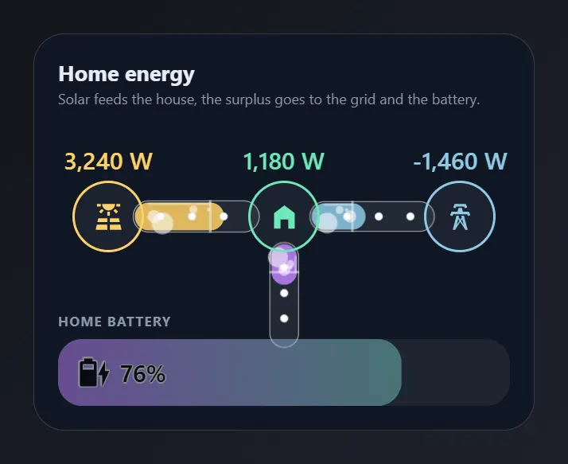

Entities: `sensor.solar_power`, `sensor.house_power`, `sensor.grid_power`, `sensor.battery_power`, `sensor.home_battery`

File: [cards/115-home-energy-tubes.yaml](cards/115-home-energy-tubes.yaml)

```yaml
# Whole-home energy: glass tubes fill with the power they carry, with a battery level below as a large fill.
# Entities: sensor.solar_power, sensor.house_power, sensor.grid_power, sensor.battery_power, sensor.home_battery
type: custom:magic-card
name: Home energy
background: "#0f1724"
border_radius: 26px
padding: 20px
box_shadow: "0 18px 40px rgba(0,0,0,0.35)"
pause_button_corner: top-right
rows:
  - id: head
    columns:
      - gap: 2px
        modules:
          - type: text
            text: Home energy
            design: { font_size: 18px, font_weight: "700", color: "#e6edf7" }
          - type: text
            text: "Solar feeds the house, the surplus goes to the grid and the battery."
            design: { font_size: 12px, color: "#8a98ad" }
  - id: sources
    padding: 20px 0 0
    column_widths: [84px, 1fr, 84px, 1fr, 84px]
    columns:
      - gap: 4px
        modules:
          - type: info
            entity: sensor.solar_power
            show_name: false
            show_state: true
            design: { font_size: 12px, font_weight: "700", color: "#ffd166", text_align: center, white_space: nowrap }
          - id: solar
            type: icon
            icon: mdi:solar-power-variant
            size: 26px
            design: { color: "#ffd166", width: 56px, height: 56px, display: flex, align_items: center, justify_content: center, border_radius: 50%, border: "2px solid #ffd166", background_color: "rgba(255,255,255,0.05)", margin: 0 auto }
      - modules: []
      - gap: 4px
        modules:
          - type: info
            entity: sensor.house_power
            show_name: false
            show_state: true
            design: { font_size: 12px, font_weight: "700", color: "#6ee7b7", text_align: center, white_space: nowrap }
          - id: home
            type: icon
            icon: mdi:home-variant
            size: 26px
            design: { color: "#6ee7b7", width: 56px, height: 56px, display: flex, align_items: center, justify_content: center, border_radius: 50%, border: "2px solid #6ee7b7", background_color: "rgba(255,255,255,0.05)", margin: 0 auto }
      - modules: []
      - gap: 4px
        modules:
          - type: info
            entity: sensor.grid_power
            show_name: false
            show_state: true
            design: { font_size: 12px, font_weight: "700", color: "#8ecae6", text_align: center, white_space: nowrap }
          - id: grid
            type: icon
            icon: mdi:transmission-tower
            size: 26px
            design: { color: "#8ecae6", width: 56px, height: 56px, display: flex, align_items: center, justify_content: center, border_radius: 50%, border: "2px solid #8ecae6", background_color: "rgba(255,255,255,0.05)", margin: 0 auto }
  - id: battery
    padding: 40px 0 0
    columns:
      - gap: 8px
        modules:
          - type: text
            text: Home battery
            design: { font_size: 11px, font_weight: "700", color: "#8a98ad", text_transform: uppercase, letter_spacing: 1px }
          - id: pack
            type: slider
            entity: sensor.home_battery
            min: 0
            max: 100
            track_style: big-fill
            track_thickness: 56
            icon: mdi:battery-charging-70
            fill_mode: gradient
            slider_color: "#c084fc"
            slider_color_to: "#6ee7b7"
            thumb: none
            value_position: track
flows:
  - { id: solar-home, from: solar, to: home, entity: sensor.solar_power, max: 5000, route: straight, color: "#ffd166", line_style: tube, from_anchor: box, to_anchor: box, width: 14, bubble_count: 4, tube_fill_value: true }
  - { id: home-grid, from: home, to: grid, entity: sensor.grid_power, min: 0, max: 5000, route: straight, reverse_negative: false, color: "#8ecae6", line_style: tube, from_anchor: box, to_anchor: box, width: 14, bubble_count: 4, tube_fill_value: true }
  - { id: home-pack, from: home, to: pack, entity: sensor.battery_power, max: 3000, route: straight, from_side: bottom, to_side: top, color: "#c084fc", line_style: tube, from_anchor: box, to_anchor: box, width: 14, bubble_count: 4, tube_fill_value: true }
```

## Living room

The room camera fills the card behind the other modules, with a temperature badge on top and two glass light sliders in front.

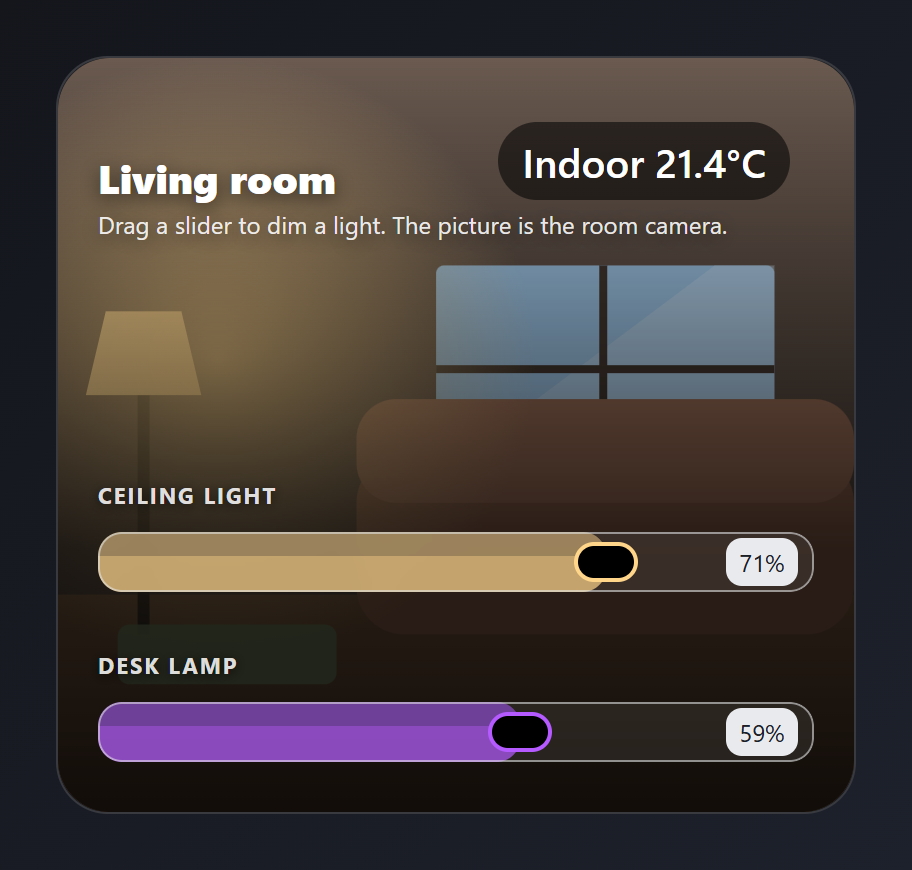

Entities: `camera.living_room`, `light.living_room`, `light.desk`, `sensor.indoor_temperature`

File: [cards/116-living-room-camera.yaml](cards/116-living-room-camera.yaml)

```yaml
# Living room: the room camera fills the card behind the other modules, with a temperature badge on top and two glass light sliders in front.
# Entities: camera.living_room, light.living_room, light.desk, sensor.indoor_temperature
type: custom:magic-card
name: Living room
background: "#14110f"
border_radius: 26px
padding: 20px
box_shadow: "0 18px 40px rgba(0,0,0,0.45)"
pause_button_corner: top-left
rows:
  - id: head
    columns:
      - gap: 2px
        modules:
          - type: camera
            entity: camera.living_room
            camera_view: snapshot
            placement: background
            layer:
              fill: card
              scrim:
                style: bottom
                strength: 70
          - type: info
            entity: sensor.indoor_temperature
            show_name: false
            show_state: true
            prefix: "Indoor "
            placement: overlay
            layer:
              anchor: top-right
              offset_x: 12px
              offset_y: 12px
            design:
              padding: 6px 12px
              border_radius: 999px
              background_color: "rgba(0,0,0,0.55)"
              color: "#ffffff"
              font_size: 12px
          - type: text
            text: Living room
            design: { font_size: 20px, font_weight: "800", color: "#ffffff", text_shadow: "0 2px 10px rgba(0,0,0,0.6)", padding_top: 26px }
          - type: text
            text: "Drag a slider to dim a light. The picture is the room camera."
            design: { font_size: 12px, color: "rgba(255,255,255,0.88)", text_shadow: "0 2px 10px rgba(0,0,0,0.6)" }
  - id: s0
    padding: 110px 0 0
    columns:
      - gap: 6px
        modules:
          - type: text
            text: Ceiling light
            design: { font_size: 11px, font_weight: "700", color: "rgba(255,255,255,0.85)", text_transform: uppercase, letter_spacing: 1px, text_shadow: "0 1px 6px rgba(0,0,0,0.7)" }
          - type: slider
            entity: light.living_room
            track_style: glass
            track_thickness: 30
            glass_blur: true
            thumb: pill
            thumb_size: 28
            value_position: track
            slider_color: "#ffd58a"
            live: true
  - id: s1
    padding: 14px 0 0
    columns:
      - gap: 6px
        modules:
          - type: text
            text: Desk lamp
            design: { font_size: 11px, font_weight: "700", color: "rgba(255,255,255,0.85)", text_transform: uppercase, letter_spacing: 1px, text_shadow: "0 1px 6px rgba(0,0,0,0.7)" }
          - type: slider
            entity: light.desk
            track_style: glass
            track_thickness: 30
            glass_blur: true
            thumb: pill
            thumb_size: 28
            value_position: track
            use_entity_color: true
            live: true
```

## Bedroom at night

The backdrop follows the sun, a moonlit skyline after dark and a day skyline before it, with glass sliders for the bedside lamp and the blinds in front.

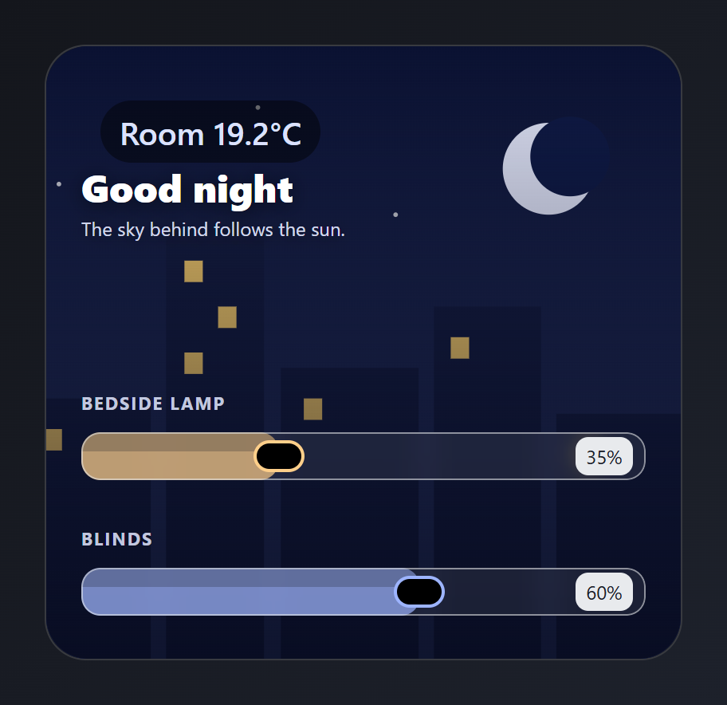

Entities: `sun.sun`, `light.bedside`, `cover.living_blinds`, `sensor.bedroom_temperature`

File: [cards/117-bedroom-night.yaml](cards/117-bedroom-night.yaml)

```yaml
# Bedroom at night: the backdrop follows the sun, a moonlit skyline after dark and a day skyline before it, with glass sliders for the bedside lamp and the blinds in front.
# Entities: sun.sun, light.bedside, cover.living_blinds, sensor.bedroom_temperature
type: custom:magic-card
name: Bedroom
entity: sun.sun
background: "#0b1233"
border_radius: 26px
padding: 22px
box_shadow: "0 18px 40px rgba(0,0,0,0.5)"
background_layers:
  - type: gradient
    gradient: "linear-gradient(to top, rgba(5,8,25,0.75), rgba(5,8,25,0.05) 70%)"
  - type: image
    entity: sun.sun
    image: /local/skyline-night.svg
    position: "85% 30%"
    states:
      above_horizon: /local/skyline-day.svg
      below_horizon: /local/skyline-night.svg
rows:
  - id: head
    columns:
      - gap: 2px
        modules:
          - type: info
            entity: sensor.bedroom_temperature
            show_name: false
            show_state: true
            prefix: "Room "
            placement: overlay
            layer:
              anchor: top-left
              offset_x: 12px
              offset_y: 12px
            design:
              padding: 6px 12px
              border_radius: 999px
              background_color: "rgba(0,0,0,0.45)"
              color: "#dbe2ff"
              font_size: 12px
          - type: text
            text: Good night
            design: { font_size: 24px, font_weight: "800", color: "#ffffff", text_shadow: "0 2px 12px rgba(0,0,0,0.5)", padding_top: 50px }
          - type: text
            text: "The sky behind follows the sun."
            design: { font_size: 12px, color: "rgba(226,232,255,0.92)", text_shadow: "0 2px 10px rgba(0,0,0,0.5)" }
  - id: lamp
    padding: 84px 0 0
    columns:
      - gap: 6px
        modules:
          - type: text
            text: Bedside lamp
            design: { font_size: 11px, font_weight: "700", color: "rgba(226,232,255,0.85)", text_transform: uppercase, letter_spacing: 1px }
          - type: slider
            entity: light.bedside
            track_style: glass
            track_thickness: 30
            glass_blur: true
            thumb: pill
            thumb_size: 28
            value_position: track
            slider_color: "#ffcf8a"
            live: true
  - id: blinds
    padding: 14px 0 0
    columns:
      - gap: 6px
        modules:
          - type: text
            text: Blinds
            design: { font_size: 11px, font_weight: "700", color: "rgba(226,232,255,0.85)", text_transform: uppercase, letter_spacing: 1px }
          - type: slider
            entity: cover.living_blinds
            track_style: glass
            track_thickness: 30
            glass_blur: true
            thumb: pill
            thumb_size: 28
            value_position: track
            slider_color: "#9db4ff"
```

## Heating

Neon flow lines run from the boiler to each room, brighter and faster for the radiators that draw more, with a neon slider for the living room target.

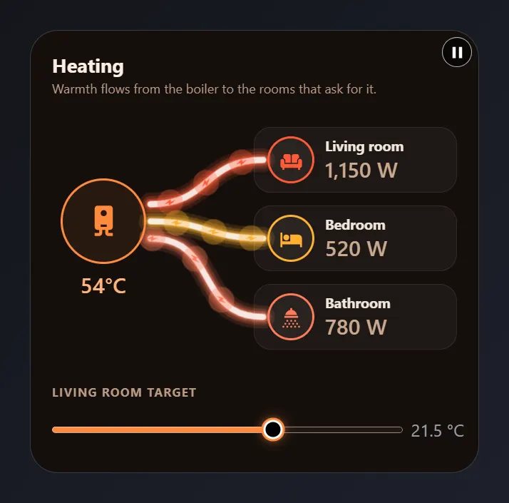

Entities: `sensor.boiler_temperature`, `sensor.radiator_living`, `sensor.radiator_bedroom`, `sensor.radiator_bathroom`, `climate.living_room`

File: [cards/118-heating-neon.yaml](cards/118-heating-neon.yaml)

```yaml
# Heating: neon flow lines run from the boiler to each room, brighter and faster for the radiators that draw more, with a neon slider for the living room target.
# Entities: sensor.boiler_temperature, sensor.radiator_living, sensor.radiator_bedroom, sensor.radiator_bathroom, climate.living_room
type: custom:magic-card
name: Heating
background: "#160f0c"
border_radius: 26px
padding: 20px
box_shadow: "0 18px 40px rgba(0,0,0,0.45)"
pause_button_corner: top-right
rows:
  - id: head
    columns:
      - gap: 2px
        modules:
          - type: text
            text: Heating
            design: { font_size: 18px, font_weight: "700", color: "#fbeee3" }
          - type: text
            text: "Warmth flows from the boiler to the rooms that ask for it."
            design: { font_size: 12px, color: "#b99a85" }
  - id: house
    padding: 18px 0 0
    column_widths: [96px, 1fr, 190px]
    columns:
      - vertical_align: center
        gap: 6px
        modules:
          - id: boiler
            type: icon
            icon: mdi:water-boiler
            size: 34px
            design: { color: "#ff8a3d", width: 76px, height: 76px, display: flex, align_items: center, justify_content: center, border_radius: 50%, border: "2px solid #ff8a3d", background_color: "rgba(255,138,61,0.08)", margin: 0 auto }
          - type: info
            entity: sensor.boiler_temperature
            show_name: false
            show_state: true
            design: { font_size: 14px, font_weight: "700", color: "#ffb37a", text_align: center }
      - modules: []
      - gap: 12px
        modules:
          - type: horizontal
            gap: 10px
            align: center
            design: { padding: 8px 12px, border_radius: 16px, background_color: "rgba(255,255,255,0.04)", border: "1px solid rgba(255,255,255,0.08)" }
            modules:
              - id: r1
                type: icon
                icon: mdi:sofa
                size: 22px
                design: { color: "#ff5a36", width: 40px, height: 40px, display: flex, align_items: center, justify_content: center, border_radius: 50%, border: "2px solid #ff5a36", background_color: "rgba(255,255,255,0.05)" }
              - type: vertical
                gap: 0px
                modules:
                  - type: text
                    text: Living room
                    design: { font_size: 13px, font_weight: "700", color: "#f1e6dc" }
                  - type: info
                    entity: sensor.radiator_living
                    show_name: false
                    show_state: true
                    design: { font_size: 12px, color: "#c9a98f" }
          - type: horizontal
            gap: 10px
            align: center
            design: { padding: 8px 12px, border_radius: 16px, background_color: "rgba(255,255,255,0.04)", border: "1px solid rgba(255,255,255,0.08)" }
            modules:
              - id: r2
                type: icon
                icon: mdi:bed
                size: 22px
                design: { color: "#ffb02e", width: 40px, height: 40px, display: flex, align_items: center, justify_content: center, border_radius: 50%, border: "2px solid #ffb02e", background_color: "rgba(255,255,255,0.05)" }
              - type: vertical
                gap: 0px
                modules:
                  - type: text
                    text: Bedroom
                    design: { font_size: 13px, font_weight: "700", color: "#f1e6dc" }
                  - type: info
                    entity: sensor.radiator_bedroom
                    show_name: false
                    show_state: true
                    design: { font_size: 12px, color: "#c9a98f" }
          - type: horizontal
            gap: 10px
            align: center
            design: { padding: 8px 12px, border_radius: 16px, background_color: "rgba(255,255,255,0.04)", border: "1px solid rgba(255,255,255,0.08)" }
            modules:
              - id: r3
                type: icon
                icon: mdi:shower-head
                size: 22px
                design: { color: "#ff7a59", width: 40px, height: 40px, display: flex, align_items: center, justify_content: center, border_radius: 50%, border: "2px solid #ff7a59", background_color: "rgba(255,255,255,0.05)" }
              - type: vertical
                gap: 0px
                modules:
                  - type: text
                    text: Bathroom
                    design: { font_size: 13px, font_weight: "700", color: "#f1e6dc" }
                  - type: info
                    entity: sensor.radiator_bathroom
                    show_name: false
                    show_state: true
                    design: { font_size: 12px, color: "#c9a98f" }
  - id: target
    padding: 22px 0 0
    columns:
      - gap: 8px
        modules:
          - type: text
            text: Living room target
            design: { font_size: 11px, font_weight: "700", color: "#b99a85", text_transform: uppercase, letter_spacing: 1px }
          - type: slider
            entity: climate.living_room
            track_style: thin
            track_thickness: 6
            thumb: circle
            thumb_size: 18
            thumb_border: 2
            thumb_glow: 10
            value_position: beside
            slider_color: "#ff8a3d"
            track_color: "#ff8a3d40"
flows:
  - { id: b-r1, from: boiler, to: r1, entity: sensor.radiator_living, max: 1500, route: curve, from_side: right, to_side: left, color: "#ff5a36", line_style: neon, width: 3, glow: 8, flicker: subtle, shape: spark, dot_size: 8, dots: 3 }
  - { id: b-r2, from: boiler, to: r2, entity: sensor.radiator_bedroom, max: 1500, route: curve, from_side: right, to_side: left, color: "#ffb02e", line_style: neon, width: 3, glow: 8, flicker: subtle, shape: spark, dot_size: 8, dots: 3 }
  - { id: b-r3, from: boiler, to: r3, entity: sensor.radiator_bathroom, max: 1500, route: curve, from_side: right, to_side: left, color: "#ff7a59", line_style: neon, width: 3, glow: 8, flicker: subtle, shape: spark, dot_size: 8, dots: 3 }
```

## Rain water tank

Tubes carry the water from the roof into the tank and out to the garden and the house, and the tank level is a tall fill.

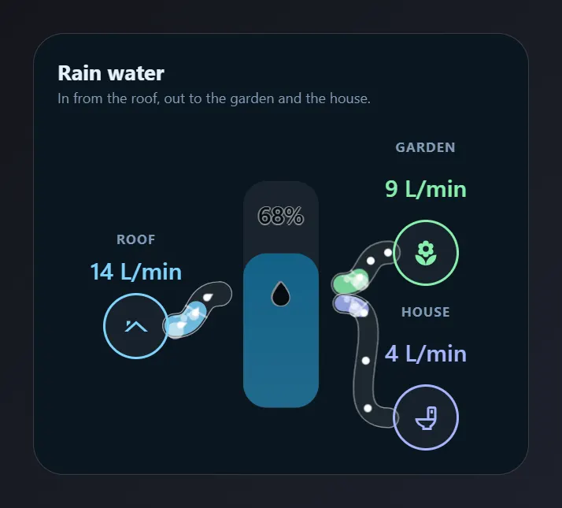

Entities: `sensor.water_tank`, `sensor.tank_inflow`, `sensor.tank_garden_flow`, `sensor.tank_house_flow`

File: [cards/119-rain-water-tank.yaml](cards/119-rain-water-tank.yaml)

```yaml
# Rain water tank: tubes carry the water from the roof into the tank and out to the garden and the house, and the tank level is a tall fill.
# Entities: sensor.water_tank, sensor.tank_inflow, sensor.tank_garden_flow, sensor.tank_house_flow
type: custom:magic-card
name: Rain water
background: "#0b1620"
border_radius: 26px
padding: 20px
box_shadow: "0 18px 40px rgba(0,0,0,0.4)"
pause_button_corner: top-right
rows:
  - id: head
    columns:
      - gap: 2px
        modules:
          - type: text
            text: Rain water
            design: { font_size: 18px, font_weight: "700", color: "#e4f1fb" }
          - type: text
            text: "In from the roof, out to the garden and the house."
            design: { font_size: 12px, color: "#7f9bb8" }
  - id: tank
    padding: 16px 0 0
    column_widths: [1fr, 96px, 1fr]
    columns:
      - vertical_align: center
        gap: 6px
        modules:
          - type: text
            text: Roof
            design: { font_size: 11px, font_weight: "700", color: "#7f9bb8", text_transform: uppercase, letter_spacing: 1px, text_align: center }
          - type: info
            entity: sensor.tank_inflow
            show_name: false
            show_state: true
            design: { font_size: 13px, font_weight: "700", color: "#7dd3fc", text_align: center, white_space: nowrap }
          - id: roof
            type: icon
            icon: mdi:home-roof
            size: 24px
            design: { color: "#7dd3fc", width: 52px, height: 52px, display: flex, align_items: center, justify_content: center, border_radius: 50%, border: "2px solid #7dd3fc", background_color: "rgba(255,255,255,0.05)", margin: 0 auto }
      - vertical_align: center
        modules:
          - id: level
            type: slider
            entity: sensor.water_tank
            min: 0
            max: 100
            direction: vertical
            track_style: big-fill
            fill_mode: gradient
            slider_color: "#38bdf8"
            slider_color_to: "#0ea5e9"
            icon: mdi:water
            icon_position: center
            thumb: none
            value_position: track
      - vertical_align: center
        gap: 14px
        modules:
          - type: text
            text: Garden
            design: { font_size: 11px, font_weight: "700", color: "#7f9bb8", text_transform: uppercase, letter_spacing: 1px, text_align: center }
          - type: info
            entity: sensor.tank_garden_flow
            show_name: false
            show_state: true
            design: { font_size: 13px, font_weight: "700", color: "#86efac", text_align: center, white_space: nowrap }
          - id: garden
            type: icon
            icon: mdi:flower
            size: 24px
            design: { color: "#86efac", width: 52px, height: 52px, display: flex, align_items: center, justify_content: center, border_radius: 50%, border: "2px solid #86efac", background_color: "rgba(255,255,255,0.05)", margin: 0 auto }
          - type: text
            text: House
            design: { font_size: 11px, font_weight: "700", color: "#7f9bb8", text_transform: uppercase, letter_spacing: 1px, text_align: center }
          - type: info
            entity: sensor.tank_house_flow
            show_name: false
            show_state: true
            design: { font_size: 13px, font_weight: "700", color: "#a5b4fc", text_align: center, white_space: nowrap }
          - id: house
            type: icon
            icon: mdi:toilet
            size: 24px
            design: { color: "#a5b4fc", width: 52px, height: 52px, display: flex, align_items: center, justify_content: center, border_radius: 50%, border: "2px solid #a5b4fc", background_color: "rgba(255,255,255,0.05)", margin: 0 auto }

flows:
  - { id: roof-tank, from: roof, to: level, entity: sensor.tank_inflow, max: 30, route: curve, from_side: right, to_side: left, color: "#7dd3fc", line_style: tube, from_anchor: box, to_anchor: box, width: 12, bubble_count: 4, tube_fill_value: true, shape: drop, dot_size: 7, dots: 3, arrival: splash, arrival_size: 26 }
  - { id: tank-garden, from: level, to: garden, entity: sensor.tank_garden_flow, max: 30, route: curve, from_side: right, to_side: left, color: "#86efac", line_style: tube, from_anchor: box, to_anchor: box, width: 12, bubble_count: 4, tube_fill_value: true }
  - { id: tank-house, from: level, to: house, entity: sensor.tank_house_flow, max: 30, route: curve, from_side: right, to_side: left, color: "#a5b4fc", line_style: tube, from_anchor: box, to_anchor: box, width: 12, bubble_count: 4, tube_fill_value: true }
```

## Car charging

A twisted cable carries lightning bolts from the house to the charger and on to the car, with the battery as a large fill and a charge limit slider with named stops.

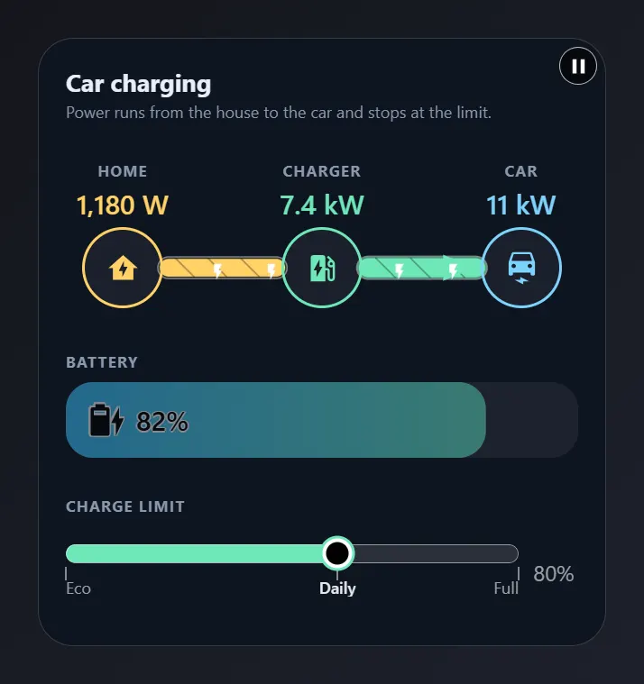

Entities: `sensor.house_power`, `sensor.ev_charger_power`, `sensor.car_charge_power`, `sensor.car_battery`, `input_number.ev_charge_limit`

File: [cards/120-car-charging-cable.yaml](cards/120-car-charging-cable.yaml)

```yaml
# Car charging: a twisted cable carries lightning bolts from the house to the charger and on to the car, with the battery as a large fill and a charge limit slider with named stops.
# Entities: sensor.house_power, sensor.ev_charger_power, sensor.car_charge_power, sensor.car_battery, input_number.ev_charge_limit
type: custom:magic-card
name: Car charging
background: "#0e1420"
border_radius: 26px
padding: 20px
box_shadow: "0 18px 40px rgba(0,0,0,0.4)"
pause_button_corner: top-right
rows:
  - id: head
    columns:
      - gap: 2px
        modules:
          - type: text
            text: Car charging
            design: { font_size: 18px, font_weight: "700", color: "#e8eefb" }
          - type: text
            text: "Power runs from the house to the car and stops at the limit."
            design: { font_size: 12px, color: "#8a98ad" }
  - id: chain
    padding: 18px 0 0
    column_widths: [84px, 1fr, 84px, 1fr, 84px]
    columns:
      - gap: 4px
        modules:
          - type: text
            text: Home
            design: { font_size: 11px, font_weight: "700", color: "#8a98ad", text_transform: uppercase, letter_spacing: 1px, text_align: center }
          - type: info
            entity: sensor.house_power
            show_name: false
            show_state: true
            design: { font_size: 13px, font_weight: "700", color: "#ffd166", text_align: center, white_space: nowrap }
          - id: home
            type: icon
            icon: mdi:home-lightning-bolt
            size: 26px
            design: { color: "#ffd166", width: 56px, height: 56px, display: flex, align_items: center, justify_content: center, border_radius: 50%, border: "2px solid #ffd166", background_color: "rgba(255,255,255,0.05)", margin: 0 auto }
      - modules: []
      - gap: 4px
        modules:
          - type: text
            text: Charger
            design: { font_size: 11px, font_weight: "700", color: "#8a98ad", text_transform: uppercase, letter_spacing: 1px, text_align: center }
          - type: info
            entity: sensor.ev_charger_power
            show_name: false
            show_state: true
            design: { font_size: 13px, font_weight: "700", color: "#6ee7b7", text_align: center, white_space: nowrap }
          - id: charger
            type: icon
            icon: mdi:ev-station
            size: 26px
            design: { color: "#6ee7b7", width: 56px, height: 56px, display: flex, align_items: center, justify_content: center, border_radius: 50%, border: "2px solid #6ee7b7", background_color: "rgba(255,255,255,0.05)", margin: 0 auto }
      - modules: []
      - gap: 4px
        modules:
          - type: text
            text: Car
            design: { font_size: 11px, font_weight: "700", color: "#8a98ad", text_transform: uppercase, letter_spacing: 1px, text_align: center }
          - type: info
            entity: sensor.car_charge_power
            show_name: false
            show_state: true
            design: { font_size: 13px, font_weight: "700", color: "#7dd3fc", text_align: center, white_space: nowrap }
          - id: car
            type: icon
            icon: mdi:car-electric
            size: 26px
            design: { color: "#7dd3fc", width: 56px, height: 56px, display: flex, align_items: center, justify_content: center, border_radius: 50%, border: "2px solid #7dd3fc", background_color: "rgba(255,255,255,0.05)", margin: 0 auto }
  - id: battery
    padding: 22px 0 0
    columns:
      - gap: 8px
        modules:
          - type: text
            text: Battery
            design: { font_size: 11px, font_weight: "700", color: "#8a98ad", text_transform: uppercase, letter_spacing: 1px }
          - type: slider
            entity: sensor.car_battery
            min: 0
            max: 100
            track_style: big-fill
            track_thickness: 56
            icon: mdi:battery-charging-80
            fill_mode: gradient
            slider_color: "#38bdf8"
            slider_color_to: "#6ee7b7"
            thumb: none
            value_position: track
  - id: limit
    padding: 18px 0 0
    columns:
      - gap: 8px
        modules:
          - type: text
            text: Charge limit
            design: { font_size: 11px, font_weight: "700", color: "#8a98ad", text_transform: uppercase, letter_spacing: 1px }
          - type: slider
            entity: input_number.ev_charge_limit
            track_style: pill
            track_thickness: 14
            thumb: circle
            thumb_size: 22
            thumb_border: 3
            value_position: beside
            slider_color: "#6ee7b7"
            snap: true
            stops:
              - { value: 50, label: Eco }
              - { value: 80, label: Daily }
              - { value: 100, label: Full }
flows:
  - { id: home-charger, from: home, to: charger, entity: sensor.house_power, max: 3000, route: straight, from_anchor: box, to_anchor: box, color: "#ffd166", line_style: cable, twisted: true, cable_color: "#3a3326", width: 8, shape: icon, shape_icon: "mdi:flash", shape_icon_rotate: false, dot_size: 14, dots: 2 }
  - { id: charger-car, from: charger, to: car, entity: sensor.car_charge_power, max: 11, route: straight, from_anchor: box, to_anchor: box, color: "#6ee7b7", line_style: cable, twisted: true, width: 8, shape: icon, shape_icon: "mdi:flash", shape_icon_rotate: false, dot_size: 14, dots: 2, arrival: ring, arrival_size: 40, end_cap: arrow }
```

## Garden irrigation

Wave lines carry water from the tap to each zone, thicker for the zone that uses more, with a minimal slider for the run time.

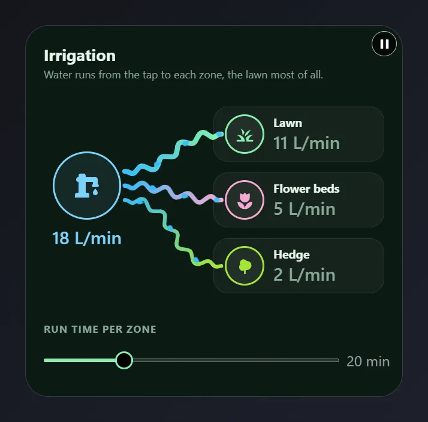

Entities: `sensor.irrigation_flow`, `sensor.zone_lawn_flow`, `sensor.zone_beds_flow`, `sensor.zone_hedge_flow`, `input_number.zone_minutes`

File: [cards/121-garden-irrigation-waves.yaml](cards/121-garden-irrigation-waves.yaml)

```yaml
# Garden irrigation: wave lines carry water from the tap to each zone, thicker for the zone that uses more, with a minimal slider for the run time.
# Entities: sensor.irrigation_flow, sensor.zone_lawn_flow, sensor.zone_beds_flow, sensor.zone_hedge_flow, input_number.zone_minutes
type: custom:magic-card
name: Irrigation
background: "#0c1a14"
border_radius: 26px
padding: 20px
box_shadow: "0 18px 40px rgba(0,0,0,0.4)"
pause_button_corner: top-right
rows:
  - id: head
    columns:
      - gap: 2px
        modules:
          - type: text
            text: Irrigation
            design: { font_size: 18px, font_weight: "700", color: "#e6f6ec" }
          - type: text
            text: "Water runs from the tap to each zone, the lawn most of all."
            design: { font_size: 12px, color: "#86a894" }
  - id: zones
    padding: 18px 0 0
    column_widths: [96px, 1fr, 190px]
    columns:
      - vertical_align: center
        gap: 6px
        modules:
          - id: tap
            type: icon
            icon: mdi:water-pump
            size: 32px
            design: { color: "#7dd3fc", width: 72px, height: 72px, display: flex, align_items: center, justify_content: center, border_radius: 50%, border: "2px solid #7dd3fc", background_color: "rgba(125,211,252,0.08)", margin: 0 auto }
          - type: info
            entity: sensor.irrigation_flow
            show_name: false
            show_state: true
            design: { font_size: 13px, font_weight: "700", color: "#7dd3fc", text_align: center, white_space: nowrap }
      - modules: []
      - gap: 12px
        modules:
          - type: horizontal
            gap: 10px
            align: center
            design: { padding: 8px 12px, border_radius: 16px, background_color: "rgba(255,255,255,0.04)", border: "1px solid rgba(255,255,255,0.08)" }
            modules:
              - id: lawn
                type: icon
                icon: mdi:grass
                size: 22px
                design: { color: "#86efac", width: 40px, height: 40px, display: flex, align_items: center, justify_content: center, border_radius: 50%, border: "2px solid #86efac", background_color: "rgba(255,255,255,0.05)" }
              - type: vertical
                gap: 0px
                modules:
                  - type: text
                    text: Lawn
                    design: { font_size: 13px, font_weight: "700", color: "#e6f6ec" }
                  - type: info
                    entity: sensor.zone_lawn_flow
                    show_name: false
                    show_state: true
                    design: { font_size: 12px, color: "#86a894" }
          - type: horizontal
            gap: 10px
            align: center
            design: { padding: 8px 12px, border_radius: 16px, background_color: "rgba(255,255,255,0.04)", border: "1px solid rgba(255,255,255,0.08)" }
            modules:
              - id: beds
                type: icon
                icon: mdi:flower-tulip
                size: 22px
                design: { color: "#f9a8d4", width: 40px, height: 40px, display: flex, align_items: center, justify_content: center, border_radius: 50%, border: "2px solid #f9a8d4", background_color: "rgba(255,255,255,0.05)" }
              - type: vertical
                gap: 0px
                modules:
                  - type: text
                    text: Flower beds
                    design: { font_size: 13px, font_weight: "700", color: "#e6f6ec" }
                  - type: info
                    entity: sensor.zone_beds_flow
                    show_name: false
                    show_state: true
                    design: { font_size: 12px, color: "#86a894" }
          - type: horizontal
            gap: 10px
            align: center
            design: { padding: 8px 12px, border_radius: 16px, background_color: "rgba(255,255,255,0.04)", border: "1px solid rgba(255,255,255,0.08)" }
            modules:
              - id: hedge
                type: icon
                icon: mdi:tree
                size: 22px
                design: { color: "#a3e635", width: 40px, height: 40px, display: flex, align_items: center, justify_content: center, border_radius: 50%, border: "2px solid #a3e635", background_color: "rgba(255,255,255,0.05)" }
              - type: vertical
                gap: 0px
                modules:
                  - type: text
                    text: Hedge
                    design: { font_size: 13px, font_weight: "700", color: "#e6f6ec" }
                  - type: info
                    entity: sensor.zone_hedge_flow
                    show_name: false
                    show_state: true
                    design: { font_size: 12px, color: "#86a894" }
  - id: runtime
    padding: 22px 0 0
    columns:
      - gap: 8px
        modules:
          - type: text
            text: Run time per zone
            design: { font_size: 11px, font_weight: "700", color: "#86a894", text_transform: uppercase, letter_spacing: 1px }
          - type: slider
            entity: input_number.zone_minutes
            track_style: thin
            track_thickness: 4
            thumb: circle
            thumb_size: 16
            value_position: beside
            slider_color: "#86efac"
flows:
  - { id: tap-lawn, from: tap, to: lawn, entity: sensor.zone_lawn_flow, max: 15, route: curve, from_side: right, to_side: left, color: "#38bdf8", color_to: "#86efac", line_style: wave, amplitude: 4, wavelength: 26, width: 3, shape: drop, dot_size: 7, dots: 3, arrival: splash, arrival_size: 26 }
  - { id: tap-beds, from: tap, to: beds, entity: sensor.zone_beds_flow, max: 15, route: curve, from_side: right, to_side: left, color: "#38bdf8", color_to: "#f9a8d4", line_style: wave, amplitude: 4, wavelength: 26, width: 3, shape: drop, dot_size: 7, dots: 3 }
  - { id: tap-hedge, from: tap, to: hedge, entity: sensor.zone_hedge_flow, max: 15, route: curve, from_side: right, to_side: left, color: "#38bdf8", color_to: "#a3e635", line_style: wave, amplitude: 4, wavelength: 26, width: 3, shape: drop, dot_size: 7, dots: 3 }
```

## Kitchen power

Double rails run from the kitchen circuit to each appliance, red for a hungry oven and green for a quiet fridge, with a kitchen light slider underneath.

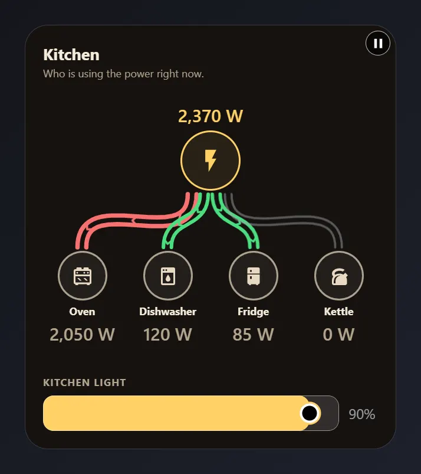

Entities: `sensor.kitchen_power`, `sensor.oven_power`, `sensor.dishwasher_power`, `sensor.fridge_power`, `sensor.kettle_power`, `light.kitchen`

File: [cards/122-kitchen-power-rails.yaml](cards/122-kitchen-power-rails.yaml)

```yaml
# Kitchen power: double rails run from the kitchen circuit to each appliance, red for a hungry oven and green for a quiet fridge, with a kitchen light slider underneath.
# Entities: sensor.kitchen_power, sensor.oven_power, sensor.dishwasher_power, sensor.fridge_power, sensor.kettle_power, light.kitchen
type: custom:magic-card
name: Kitchen
background: "#17120f"
border_radius: 26px
padding: 20px
box_shadow: "0 18px 40px rgba(0,0,0,0.45)"
pause_button_corner: top-right
rows:
  - id: head
    columns:
      - gap: 2px
        modules:
          - type: text
            text: Kitchen
            design: { font_size: 18px, font_weight: "700", color: "#f6ecda" }
          - type: text
            text: "Who is using the power right now."
            design: { font_size: 12px, color: "#b3a58e" }
  - id: hub
    padding: 16px 0 0
    columns:
      - gap: 4px
        modules:
          - type: info
            entity: sensor.kitchen_power
            show_name: false
            show_state: true
            design: { font_size: 13px, font_weight: "700", color: "#ffd166", text_align: center, white_space: nowrap }
          - id: circuit
            type: icon
            icon: mdi:flash
            size: 30px
            design: { color: "#ffd166", width: 64px, height: 64px, display: flex, align_items: center, justify_content: center, border_radius: 50%, border: "2px solid #ffd166", background_color: "rgba(255,209,102,0.08)", margin: 0 auto }
  - id: appliances
    padding: 58px 0 0
    layout: "1-1-1-1"
    columns:
      - gap: 4px
        modules:
          - id: oven
            type: icon
            icon: mdi:stove
            size: 24px
            design: { color: "#e8d9c2", width: 52px, height: 52px, display: flex, align_items: center, justify_content: center, border_radius: 50%, border: "2px solid rgba(232,217,194,0.7)", background_color: "rgba(255,255,255,0.05)", margin: 0 auto }
          - type: text
            text: Oven
            design: { font_size: 12px, font_weight: "700", color: "#f3e9d8", text_align: center }
          - type: info
            entity: sensor.oven_power
            show_name: false
            show_state: true
            design: { font_size: 12px, color: "#b3a58e", text_align: center, white_space: nowrap }
      - gap: 4px
        modules:
          - id: dish
            type: icon
            icon: mdi:dishwasher
            size: 24px
            design: { color: "#e8d9c2", width: 52px, height: 52px, display: flex, align_items: center, justify_content: center, border_radius: 50%, border: "2px solid rgba(232,217,194,0.7)", background_color: "rgba(255,255,255,0.05)", margin: 0 auto }
          - type: text
            text: Dishwasher
            design: { font_size: 12px, font_weight: "700", color: "#f3e9d8", text_align: center }
          - type: info
            entity: sensor.dishwasher_power
            show_name: false
            show_state: true
            design: { font_size: 12px, color: "#b3a58e", text_align: center, white_space: nowrap }
      - gap: 4px
        modules:
          - id: fridge
            type: icon
            icon: mdi:fridge
            size: 24px
            design: { color: "#e8d9c2", width: 52px, height: 52px, display: flex, align_items: center, justify_content: center, border_radius: 50%, border: "2px solid rgba(232,217,194,0.7)", background_color: "rgba(255,255,255,0.05)", margin: 0 auto }
          - type: text
            text: Fridge
            design: { font_size: 12px, font_weight: "700", color: "#f3e9d8", text_align: center }
          - type: info
            entity: sensor.fridge_power
            show_name: false
            show_state: true
            design: { font_size: 12px, color: "#b3a58e", text_align: center, white_space: nowrap }
      - gap: 4px
        modules:
          - id: kettle
            type: icon
            icon: mdi:kettle
            size: 24px
            design: { color: "#e8d9c2", width: 52px, height: 52px, display: flex, align_items: center, justify_content: center, border_radius: 50%, border: "2px solid rgba(232,217,194,0.7)", background_color: "rgba(255,255,255,0.05)", margin: 0 auto }
          - type: text
            text: Kettle
            design: { font_size: 12px, font_weight: "700", color: "#f3e9d8", text_align: center }
          - type: info
            entity: sensor.kettle_power
            show_name: false
            show_state: true
            design: { font_size: 12px, color: "#b3a58e", text_align: center, white_space: nowrap }
  - id: light
    padding: 24px 0 0
    columns:
      - gap: 8px
        modules:
          - type: text
            text: Kitchen light
            design: { font_size: 11px, font_weight: "700", color: "#b3a58e", text_transform: uppercase, letter_spacing: 1px }
          - type: slider
            entity: light.kitchen
            track_style: standard
            thumb: circle
            thumb_size: 22
            thumb_border: 3
            value_position: beside
            slider_color: "#ffd166"
flows:
  - { id: c-oven, from: circuit, to: oven, entity: sensor.oven_power, max: 2500, route: curve, from_side: bottom, to_side: top, color: "#4ade80", line_style: double, rail_gap: 5, width: 2.5, color_mode: value, thresholds: [{ from: 0, color: "#4ade80" }, { from: 500, color: "#facc15" }, { from: 1500, color: "#f87171" }], shape: chevron, dot_size: 8, dots: 3 }
  - { id: c-dish, from: circuit, to: dish, entity: sensor.dishwasher_power, max: 2500, route: curve, from_side: bottom, to_side: top, color: "#4ade80", line_style: double, rail_gap: 5, width: 2.5, color_mode: value, thresholds: [{ from: 0, color: "#4ade80" }, { from: 500, color: "#facc15" }, { from: 1500, color: "#f87171" }], shape: chevron, dot_size: 8, dots: 3 }
  - { id: c-fridge, from: circuit, to: fridge, entity: sensor.fridge_power, max: 2500, route: curve, from_side: bottom, to_side: top, color: "#4ade80", line_style: double, rail_gap: 5, width: 2.5, color_mode: value, thresholds: [{ from: 0, color: "#4ade80" }, { from: 500, color: "#facc15" }, { from: 1500, color: "#f87171" }], shape: chevron, dot_size: 8, dots: 3 }
  - { id: c-kettle, from: circuit, to: kettle, entity: sensor.kettle_power, max: 2500, route: curve, from_side: bottom, to_side: top, color: "#4ade80", line_style: double, rail_gap: 5, width: 2.5, color_mode: value, thresholds: [{ from: 0, color: "#4ade80" }, { from: 500, color: "#facc15" }, { from: 1500, color: "#f87171" }], shape: chevron, dot_size: 8, dots: 3 }
```

## Media room

The album art, blurred and slowly zooming, glows behind the player, and the volume is a large live fill.

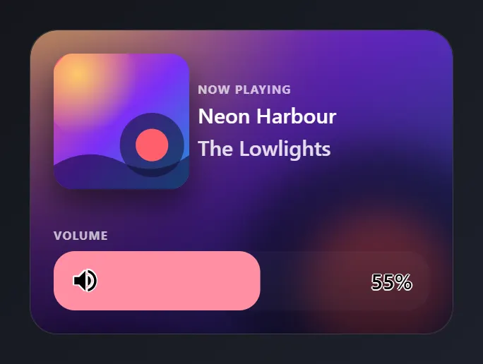

Entities: `media_player.media_room`

File: [cards/123-media-room-album-glow.yaml](cards/123-media-room-album-glow.yaml)

```yaml
# Media room: the album art, blurred and slowly zooming, glows behind the player, and the volume is a large live fill.
# Entities: media_player.media_room
type: custom:magic-card
name: Media room
entity: media_player.media_room
background: "#0b0a14"
border_radius: 26px
padding: 22px
box_shadow: "0 18px 40px rgba(0,0,0,0.5)"
pause_button_corner: top-right
background_layers:
  - type: gradient
    gradient: "linear-gradient(to top, rgba(8,6,20,0.8), rgba(8,6,20,0.25))"
  - type: image
    entity: media_player.media_room
    attribute: entity_picture
    blur: 18
    pan_zoom:
      from: 110
      to: 150
      focus: center
      duration: 12
      alternate: true
      pause_when_idle: true
rows:
  - id: now
    column_widths: [128px, 1fr]
    columns:
      - modules:
          - type: image
            entity: media_player.media_room
            entity_picture: true
            aspect_ratio: "1"
            design:
              border_radius: 18px
              box_shadow: "0 14px 30px rgba(0,0,0,0.55)"
      - vertical_align: center
        gap: 4px
        modules:
          - type: text
            text: "Now playing"
            design: { font_size: 11px, font_weight: "700", color: "rgba(255,255,255,0.7)", text_transform: uppercase, letter_spacing: 1px }
          - type: info
            entity: media_player.media_room
            attribute: media_title
            show_name: false
            show_state: true
            design: { font_size: 20px, font_weight: "800", color: "#ffffff" }
          - type: info
            entity: media_player.media_room
            attribute: media_artist
            show_name: false
            show_state: true
            design: { font_size: 14px, color: "rgba(255,255,255,0.85)" }
  - id: volume
    padding: 26px 0 0
    columns:
      - gap: 8px
        modules:
          - type: text
            text: Volume
            design: { font_size: 11px, font_weight: "700", color: "rgba(255,255,255,0.7)", text_transform: uppercase, letter_spacing: 1px }
          - type: slider
            entity: media_player.media_room
            attribute: volume_level
            track_style: big-fill
            track_thickness: 56
            icon: mdi:volume-high
            fill_mode: solid
            slider_color: "#ff8fa3"
            track_color: "rgba(255,255,255,0.14)"
            thumb: none
            value_position: track
            live: true
```

## Front door

The camera fills the card behind the other modules, with a doorbell badge and a lock badge on top, a fade for the text and a glass slider for the porch light.

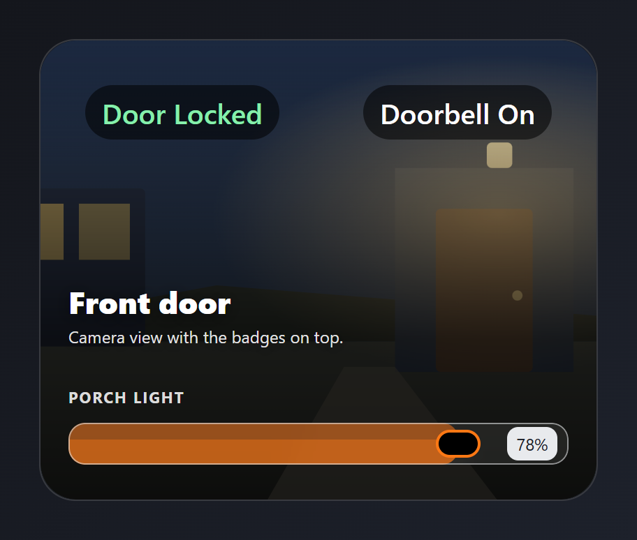

Entities: `camera.front_door`, `binary_sensor.front_doorbell`, `lock.front_door`, `light.porch`

File: [cards/124-doorbell-security.yaml](cards/124-doorbell-security.yaml)

```yaml
# Front door: the camera fills the card behind the other modules, with a doorbell badge and a lock badge on top, a fade for the text and a glass slider for the porch light.
# Entities: camera.front_door, binary_sensor.front_doorbell, lock.front_door, light.porch
type: custom:magic-card
name: Front door
background: "#0e1116"
border_radius: 26px
padding: 20px
box_shadow: "0 18px 40px rgba(0,0,0,0.5)"
rows:
  - id: view
    columns:
      - gap: 2px
        vertical_align: end
        design: { min_height: 200px }
        modules:
          - type: camera
            entity: camera.front_door
            camera_view: snapshot
            placement: background
            layer:
              fill: card
              scrim:
                style: bottom
                strength: 70
          - type: info
            entity: binary_sensor.front_doorbell
            show_name: false
            show_state: true
            prefix: "Doorbell "
            placement: overlay
            layer:
              anchor: top-right
              offset_x: 12px
              offset_y: 12px
            design:
              padding: 6px 12px
              border_radius: 999px
              background_color: "rgba(0,0,0,0.55)"
              color: "#ffffff"
              font_size: 12px
          - type: info
            entity: lock.front_door
            show_name: false
            show_state: true
            prefix: "Door "
            placement: overlay
            layer:
              anchor: top-left
              offset_x: 12px
              offset_y: 12px
            design:
              padding: 6px 12px
              border_radius: 999px
              background_color: "rgba(0,0,0,0.55)"
              color: "#86efac"
              font_size: 12px
          - type: text
            text: Front door
            design: { font_size: 22px, font_weight: "800", color: "#ffffff", text_shadow: "0 2px 12px rgba(0,0,0,0.6)" }
          - type: text
            text: "Camera view with the badges on top."
            design: { font_size: 12px, color: "rgba(255,255,255,0.88)", text_shadow: "0 2px 10px rgba(0,0,0,0.6)" }
  - id: porch
    padding: 18px 0 0
    columns:
      - gap: 6px
        modules:
          - type: text
            text: Porch light
            design: { font_size: 11px, font_weight: "700", color: "rgba(255,255,255,0.85)", text_transform: uppercase, letter_spacing: 1px }
          - type: slider
            entity: light.porch
            track_style: glass
            track_thickness: 30
            glass_blur: true
            thumb: pill
            thumb_size: 28
            value_position: track
            use_entity_color: true
            live: true
```

## Reactor bay

Neon flows with a glow and a flicker link the solar array, the core and the cell bank, and a hexagon Big fill slider sets the output limit. A grid pattern over a deep gradient sits behind it all.

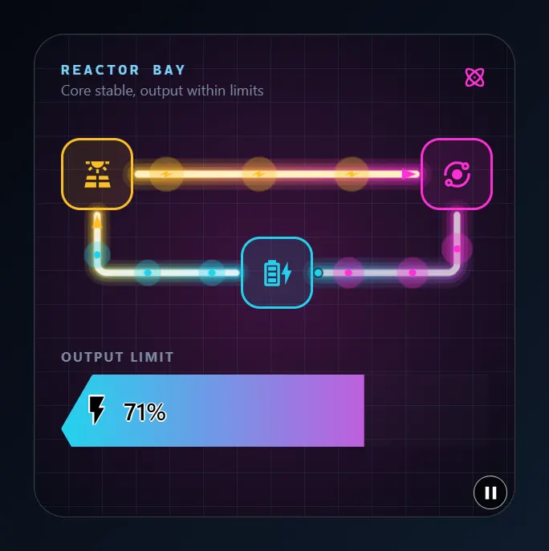

Entities: `sensor.solar_power`, `sensor.house_power`, `sensor.battery_power`, `light.living_room`

File: [cards/125-reactor-bay.yaml](cards/125-reactor-bay.yaml)

```yaml
# Reactor bay: neon flows with a glow and a flicker link the solar array, the core and the cell bank, and a hexagon Big fill slider sets the output limit. A grid pattern over a deep gradient sits behind it all.
# Entities: sensor.solar_power, sensor.house_power, sensor.battery_power, light.living_room
type: custom:magic-card
name: Reactor bay
background: "#070b14"
border_radius: 26px
padding: 22px 22px 58px
box_shadow: "0 20px 44px rgba(0,0,0,0.55)"
pause_button_corner: bottom-right
background_layers:
  - type: pattern
    pattern: grid
    color: "rgba(80,220,255,0.08)"
    size: 28
    thickness: 1
  - type: gradient
    gradient: "radial-gradient(circle at 70% 20%, rgba(255,47,214,0.22), rgba(7,11,20,0) 60%)"
rows:
  - id: head
    column_widths: [1fr, auto]
    columns:
      - gap: 2px
        modules:
          - type: text
            text: Reactor bay
            design: { font_size: 12px, font_weight: "700", color: "#7dd3fc", text_transform: uppercase, letter_spacing: 2.5px, font_family: "ui-monospace, 'Cascadia Mono', Menlo, monospace" }
          - type: text
            text: "Core stable, output within limits"
            design: { font_size: 12px, color: "#7b8aa3" }
      - vertical_align: start
        modules:
          - type: icon
            icon: mdi:atom
            size: 22px
            design: { color: "#ff2fd6" }
  - id: top
    column_widths: [56px, 1fr, 56px]
    padding: 22px 0 0
    columns:
      - vertical_align: center
        modules:
          - id: a
            type: icon
            icon: mdi:solar-power-variant
            size: 26px
            design: { color: "#fbbf24", width: 56px, height: 56px, display: flex, align_items: center, justify_content: center, border_radius: 16px, border: "2px solid #fbbf24", background_color: "rgba(251,191,36,0.1)" }
      - modules: []
      - vertical_align: center
        modules:
          - id: b
            type: icon
            icon: mdi:atom-variant
            size: 26px
            design: { color: "#ff2fd6", width: 56px, height: 56px, display: flex, align_items: center, justify_content: center, border_radius: 16px, border: "2px solid #ff2fd6", background_color: "rgba(255,47,214,0.1)" }
  - id: middle
    column_widths: [1fr, 56px, 1fr]
    padding: 12px 0 0
    columns:
      - modules: []
      - vertical_align: center
        modules:
          - id: c
            type: icon
            icon: mdi:battery-charging-high
            size: 26px
            design: { color: "#22d3ee", width: 56px, height: 56px, display: flex, align_items: center, justify_content: center, border_radius: 16px, border: "2px solid #22d3ee", background_color: "rgba(34,211,238,0.1)" }
      - modules: []
  - id: limit
    padding: 22px 0 0
    columns:
      - gap: 8px
        modules:
          - type: text
            text: Output limit
            design: { font_size: 11px, font_weight: "700", color: "#7b8aa3", text_transform: uppercase, letter_spacing: 1.5px }
          - type: slider
            entity: light.living_room
            track_shape: hexagon
            track_style: big-fill
            track_thickness: 60
            thumb: none
            value_position: track
            live: true
            icon: mdi:flash
            fill_mode: gradient
            slider_color: "#22d3ee"
            slider_color_to: "#ff2fd6"
            track_color: "rgba(255,255,255,0.06)"
flows:
  - { id: a-b, from: a, to: b, from_anchor: box, to_anchor: box, entity: sensor.solar_power, max: 5000, route: straight, color: "#fbbf24", color_to: "#ff2fd6", line_style: neon, width: 3, glow: 10, flicker: subtle, neon_core: "#fff1c2", end_cap: arrow, shape: spark, dots: 3, dot_size: 9 }
  - { id: b-c, from: b, to: c, from_anchor: box, to_anchor: box, entity: sensor.house_power, max: 5000, route: elbow, from_side: bottom, to_side: right, color: "#ff2fd6", color_to: "#22d3ee", line_style: neon, width: 3, glow: 10, flicker: strong, end_cap: round, shape: dot, dots: 3 }
  - { id: c-a, from: c, to: a, from_anchor: box, to_anchor: box, entity: sensor.battery_power, max: 3000, route: elbow, from_side: left, to_side: bottom, color: "#22d3ee", color_to: "#fbbf24", line_style: neon, width: 3, glow: 8, flicker: subtle, end_cap: arrow, arrival: ring, arrival_size: 36 }
```

## Potion lab

Glass tubes between flasks with rising bubbles. The liquid level follows the value, drops splash into each flask, and a Glass slider with blur sets the burner heat over a bubble pattern.

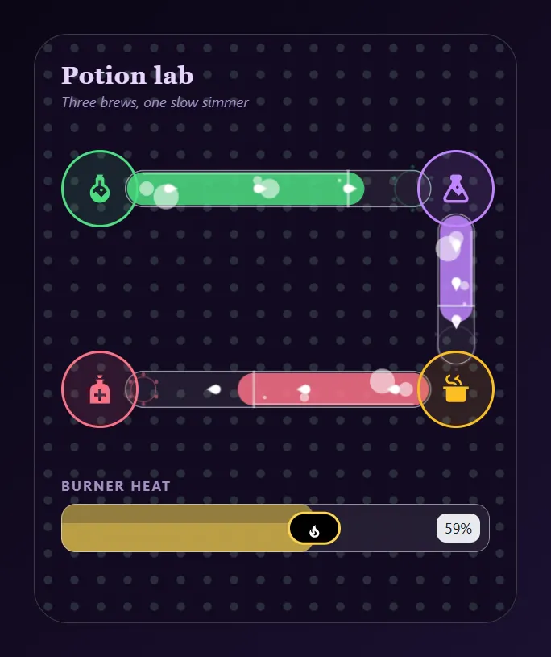

Entities: `sensor.home_battery`, `sensor.solar_power`, `sensor.house_power`, `light.desk`

File: [cards/126-potion-lab.yaml](cards/126-potion-lab.yaml)

```yaml
# Potion lab: glass tubes between flasks with rising bubbles. The liquid level follows the value, drops splash into each flask, and a Glass slider with blur sets the burner heat over a bubble pattern.
# Entities: sensor.home_battery, sensor.solar_power, sensor.house_power, light.desk
type: custom:magic-card
name: Potion lab
background: "#120a22"
border_radius: 28px
padding: 22px 22px 58px
box_shadow: "0 20px 44px rgba(0,0,0,0.55)"
pause_button_corner: bottom-right
background_layers:
  - type: pattern
    pattern: dots
    color: "rgba(190,255,220,0.14)"
    size: 22
    thickness: 3
  - type: gradient
    gradient: "radial-gradient(circle at 20% 15%, rgba(74,222,128,0.30), rgba(18,10,34,0) 55%), radial-gradient(circle at 85% 85%, rgba(168,85,247,0.32), rgba(18,10,34,0) 60%)"
rows:
  - id: head
    columns:
      - gap: 2px
        modules:
          - type: text
            text: Potion lab
            design: { font_size: 20px, font_weight: "800", color: "#e9d5ff", font_family: "Georgia, 'Times New Roman', serif", letter_spacing: 0.5px }
          - type: text
            text: "Three brews, one slow simmer"
            design: { font_size: 12px, color: "#a590c4", font_style: italic }
  - id: top
    column_widths: [60px, 1fr, 60px]
    padding: 22px 0 0
    columns:
      - vertical_align: center
        modules:
          - id: a
            type: icon
            icon: mdi:flask-round-bottom
            size: 28px
            design: { color: "#4ade80", width: 60px, height: 60px, display: flex, align_items: center, justify_content: center, border_radius: 50%, border: "2px solid #4ade80", background_color: "rgba(74,222,128,0.12)" }
      - modules: []
      - vertical_align: center
        modules:
          - id: b
            type: icon
            icon: mdi:flask
            size: 28px
            design: { color: "#c084fc", width: 60px, height: 60px, display: flex, align_items: center, justify_content: center, border_radius: 50%, border: "2px solid #c084fc", background_color: "rgba(192,132,252,0.12)" }
  - id: bottom
    column_widths: [60px, 1fr, 60px]
    padding: 92px 0 0
    columns:
      - vertical_align: center
        modules:
          - id: d
            type: icon
            icon: mdi:bottle-tonic-plus
            size: 28px
            design: { color: "#fb7185", width: 60px, height: 60px, display: flex, align_items: center, justify_content: center, border_radius: 50%, border: "2px solid #fb7185", background_color: "rgba(251,113,133,0.12)" }
      - modules: []
      - vertical_align: center
        modules:
          - id: c
            type: icon
            icon: mdi:pot-steam
            size: 28px
            design: { color: "#fbbf24", width: 60px, height: 60px, display: flex, align_items: center, justify_content: center, border_radius: 50%, border: "2px solid #fbbf24", background_color: "rgba(251,191,36,0.12)" }
  - id: heat
    padding: 30px 0 0
    columns:
      - gap: 8px
        modules:
          - type: text
            text: Burner heat
            design: { font_size: 11px, font_weight: "700", color: "#a590c4", text_transform: uppercase, letter_spacing: 1.5px }
          - type: slider
            entity: light.desk
            track_style: glass
            track_thickness: 40
            glass_blur: true
            thumb: pill
            thumb_size: 40
            thumb_icon: mdi:fire
            value_position: track
            slider_color: "#fcd34d"
flows:
  - { id: a-b, from: a, to: b, from_anchor: box, to_anchor: box, entity: sensor.home_battery, max: 100, route: straight, color: "#4ade80", line_style: tube, width: 16, bubble_count: 5, tube_fill_value: true, shape: drop, dots: 3, dot_size: 9, arrival: splash, arrival_size: 40 }
  - { id: b-c, from: b, to: c, from_anchor: box, to_anchor: box, entity: sensor.solar_power, max: 5000, route: straight, from_side: bottom, to_side: top, color: "#c084fc", line_style: tube, width: 16, bubble_count: 4, tube_fill_value: true, shape: drop, dots: 3, dot_size: 9, arrival: splash, arrival_size: 40 }
  - { id: c-d, from: c, to: d, from_anchor: box, to_anchor: box, entity: sensor.house_power, max: 2000, route: straight, color: "#fb7185", line_style: tube, width: 16, bubble_count: 4, tube_fill_value: true, shape: drop, dots: 3, dot_size: 9, arrival: splash, arrival_size: 40 }
```

## Engine room

Electric zigzag flows crackle between the reactor, the drive and the shields, with spinning stars as the charge. A slider with named stops and snapping sets the burn, over a faint scanline pattern.

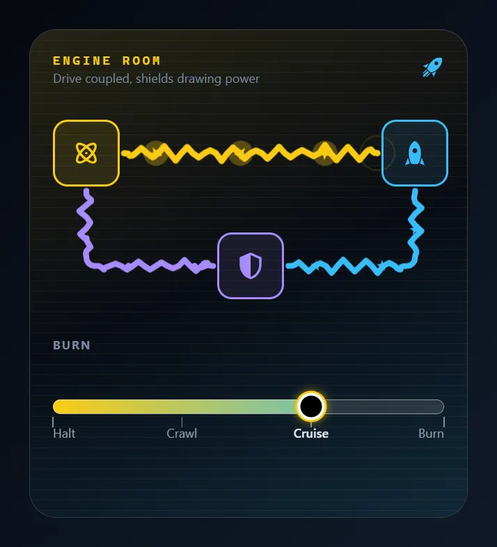

Entities: `sensor.solar_power`, `sensor.house_power`, `sensor.grid_power`, `sensor.battery_power`, `fan.bedroom`

File: [cards/127-engine-room.yaml](cards/127-engine-room.yaml)

```yaml
# Engine room: electric zigzag flows crackle between the reactor, the drive and the shields, with spinning stars as the charge. A slider with named stops and snapping sets the burn, over a faint scanline pattern.
# Entities: sensor.solar_power, sensor.house_power, sensor.grid_power, sensor.battery_power, fan.bedroom
type: custom:magic-card
name: Engine room
background: "#080c14"
border_radius: 26px
padding: 22px 22px 58px
box_shadow: "0 20px 44px rgba(0,0,0,0.55)"
pause_button_corner: bottom-right
background_layers:
  - type: pattern
    pattern: lines
    color: "rgba(250,204,21,0.06)"
    size: 10
    thickness: 1
  - type: gradient
    gradient: "linear-gradient(160deg, rgba(250,204,21,0.12) 0%, rgba(8,12,20,0) 45%, rgba(56,189,248,0.16) 100%)"
rows:
  - id: head
    column_widths: [1fr, auto]
    columns:
      - gap: 2px
        modules:
          - type: text
            text: Engine room
            design: { font_size: 12px, font_weight: "700", color: "#facc15", text_transform: uppercase, letter_spacing: 2.5px, font_family: "ui-monospace, 'Cascadia Mono', Menlo, monospace" }
          - type: text
            text: "Drive coupled, shields drawing power"
            design: { font_size: 12px, color: "#7b8aa3" }
      - modules:
          - type: icon
            icon: mdi:rocket-launch
            size: 22px
            design: { color: "#38bdf8" }
  - id: top
    column_widths: [60px, 1fr, 60px]
    padding: 22px 0 0
    columns:
      - vertical_align: center
        modules:
          - id: a
            type: icon
            icon: mdi:atom
            size: 28px
            design: { color: "#facc15", width: 60px, height: 60px, display: flex, align_items: center, justify_content: center, border_radius: 14px, border: "2px solid #facc15", background_color: "rgba(250,204,21,0.1)" }
      - modules: []
      - vertical_align: center
        modules:
          - id: b
            type: icon
            icon: mdi:rocket
            size: 28px
            design: { color: "#38bdf8", width: 60px, height: 60px, display: flex, align_items: center, justify_content: center, border_radius: 14px, border: "2px solid #38bdf8", background_color: "rgba(56,189,248,0.1)" }
  - id: bottom
    column_widths: [1fr, 60px, 1fr]
    padding: 34px 0 0
    columns:
      - modules: []
      - vertical_align: center
        modules:
          - id: c
            type: icon
            icon: mdi:shield-half-full
            size: 28px
            design: { color: "#a78bfa", width: 60px, height: 60px, display: flex, align_items: center, justify_content: center, border_radius: 14px, border: "2px solid #a78bfa", background_color: "rgba(167,139,250,0.1)" }
      - modules: []
  - id: burn
    padding: 26px 0 0
    columns:
      - gap: 0px
        modules:
          - type: text
            text: Burn
            design: { font_size: 11px, font_weight: "700", color: "#7b8aa3", text_transform: uppercase, letter_spacing: 1.5px }
          - type: slider
            entity: fan.bedroom
            min: 0
            max: 100
            track_style: pill
            track_thickness: 14
            thumb: circle
            thumb_size: 26
            thumb_border: 3
            thumb_glow: 10
            slider_color: "#facc15"
            fill_mode: gradient
            slider_color_to: "#38bdf8"
            snap: true
            value_position: bubble
            stops: [{ value: 0, label: Halt }, { value: 33, label: Crawl }, { value: 66, label: Cruise }, { value: 100, label: Burn }]
flows:
  - { id: a-b, from: a, to: b, from_anchor: box, to_anchor: box, entity: sensor.solar_power, max: 5000, route: straight, color: "#facc15", line_style: zigzag, electric: true, width: 3, amplitude: 8, wavelength: 22, glow: 6, shape: star, shape_spin: true, dot_size: 12, dots: 3, arrival: ring, arrival_size: 40 }
  - { id: b-c, from: b, to: c, from_anchor: box, to_anchor: box, entity: sensor.house_power, max: 5000, route: elbow, from_side: bottom, to_side: right, color: "#38bdf8", line_style: zigzag, electric: true, width: 3, amplitude: 7, wavelength: 22, shape: star, shape_spin: true, dot_size: 10, dots: 3 }
  - { id: c-a, from: c, to: a, from_anchor: box, to_anchor: box, entity: sensor.grid_power, max: 5000, route: elbow, from_side: left, to_side: bottom, color: "#a78bfa", line_style: zigzag, electric: true, width: 3, amplitude: 7, wavelength: 22, end_cap: arrow }
```

## Dragon vault

Gold flows from the mine, through the vault and out to the market, with spinning gold stars and diamonds. A cave picture sits behind a pattern and a warm gradient, slowly zooming, and a ticket-shaped slider sets the price.

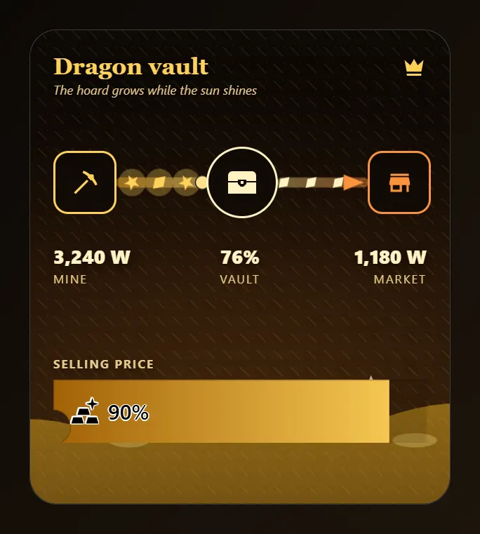

Entities: `sensor.solar_power`, `sensor.house_power`, `sensor.battery_power`, `light.kitchen`

File: [cards/128-dragon-vault.yaml](cards/128-dragon-vault.yaml)

```yaml
# Dragon vault: gold flows from the mine, through the vault and out to the market, with spinning gold stars and diamonds. A cave picture sits behind a pattern and a warm gradient, slowly zooming, and a ticket-shaped slider sets the price.
# Entities: sensor.solar_power, sensor.house_power, sensor.battery_power, light.kitchen
type: custom:magic-card
name: Dragon vault
background: "#0d0804"
border_radius: 26px
padding: 22px 22px 58px
box_shadow: "0 22px 48px rgba(0,0,0,0.6)"
pause_button_corner: bottom-right
background_layers:
  - type: pattern
    pattern: diagonal
    color: "rgba(255,210,90,0.07)"
    size: 16
    thickness: 1
  - type: gradient
    gradient: "linear-gradient(to bottom, rgba(13,8,4,0.8) 0%, rgba(13,8,4,0.1) 60%, rgba(13,8,4,0.45) 100%)"
  - type: image
    image: /local/showcase-vault.svg
    size: cover
    pan_zoom: { from: 100, to: 125, duration: 24, focus: bottom }
rows:
  - id: head
    column_widths: [1fr, auto]
    columns:
      - gap: 2px
        modules:
          - type: text
            text: Dragon vault
            design: { font_size: 22px, font_weight: "800", color: "#ffd25a", font_family: "Georgia, 'Times New Roman', serif", text_shadow: "0 2px 14px rgba(0,0,0,0.7)" }
          - type: text
            text: "The hoard grows while the sun shines"
            design: { font_size: 12px, color: "#e6c88a", font_style: italic, text_shadow: "0 2px 10px rgba(0,0,0,0.7)" }
      - modules:
          - type: icon
            icon: mdi:crown
            size: 24px
            design: { color: "#ffd25a" }
  - id: chain
    column_widths: [56px, 1fr, 64px, 1fr, 56px]
    padding: 36px 0 0
    columns:
      - vertical_align: center
        modules:
          - id: a
            type: icon
            icon: mdi:pickaxe
            size: 26px
            design: { color: "#ffd25a", width: 56px, height: 56px, display: flex, align_items: center, justify_content: center, border_radius: 14px, border: "2px solid #ffd25a", background_color: "rgba(13,8,4,0.7)" }
      - modules: []
      - vertical_align: center
        modules:
          - id: b
            type: icon
            icon: mdi:treasure-chest
            size: 32px
            design: { color: "#fff3c4", width: 64px, height: 64px, display: flex, align_items: center, justify_content: center, border_radius: 50%, border: "2px solid #fff3c4", background_color: "rgba(13,8,4,0.7)" }
      - modules: []
      - vertical_align: center
        modules:
          - id: c
            type: icon
            icon: mdi:store
            size: 26px
            design: { color: "#fb923c", width: 56px, height: 56px, display: flex, align_items: center, justify_content: center, border_radius: 14px, border: "2px solid #fb923c", background_color: "rgba(13,8,4,0.7)" }
  - id: stat
    column_widths: [1fr, 1fr, 1fr]
    padding: 14px 0 0
    columns:
      - gap: 2px
        modules:
          - type: text
            use_entity: true
            entity: sensor.solar_power
            design: { font_size: 18px, font_weight: "800", color: "#fff3c4", text_align: left, text_shadow: "0 2px 10px rgba(0,0,0,0.8)" }
          - type: text
            text: Mine
            design: { font_size: 11px, color: "#e6c88a", text_transform: uppercase, letter_spacing: 1.5px, text_align: left }
      - gap: 2px
        modules:
          - type: text
            use_entity: true
            entity: sensor.home_battery
            design: { font_size: 18px, font_weight: "800", color: "#fff3c4", text_align: center, text_shadow: "0 2px 10px rgba(0,0,0,0.8)" }
          - type: text
            text: Vault
            design: { font_size: 11px, color: "#e6c88a", text_transform: uppercase, letter_spacing: 1.5px, text_align: center }
      - gap: 2px
        modules:
          - type: text
            use_entity: true
            entity: sensor.house_power
            design: { font_size: 18px, font_weight: "800", color: "#fff3c4", text_align: right, text_shadow: "0 2px 10px rgba(0,0,0,0.8)" }
          - type: text
            text: Market
            design: { font_size: 11px, color: "#e6c88a", text_transform: uppercase, letter_spacing: 1.5px, text_align: right }
  - id: price
    padding: 56px 0 0
    columns:
      - gap: 8px
        modules:
          - type: text
            text: Selling price
            design: { font_size: 11px, font_weight: "700", color: "#e6c88a", text_transform: uppercase, letter_spacing: 1.5px, text_shadow: "0 2px 8px rgba(0,0,0,0.8)" }
          - type: slider
            entity: light.kitchen
            track_shape: ticket
            track_style: big-fill
            track_thickness: 60
            thumb: none
            value_position: track
            fill_mode: gradient
            slider_color: "#a16207"
            slider_color_to: "#ffd25a"
            track_color: "rgba(13,8,4,0.6)"
            icon: mdi:gold
flows:
  - { id: a-b, from: a, to: b, from_anchor: box, to_anchor: box, entity: sensor.solar_power, max: 5000, route: straight, color: "#f59e0b", color_to: "#ffe08a", width: 5, shape: star, shape_spin: true, shape_alternate: diamond, shape_color: "#ffd25a", dot_size: 14, dots: 3, glow: 6, end_cap: round }
  - { id: b-c, from: b, to: c, from_anchor: box, to_anchor: box, entity: sensor.house_power, max: 2500, route: straight, color: "#ffe08a", color_to: "#fb923c", width: 5, shape: diamond, shape_spin: true, shape_color: "#fff3c4", dot_size: 12, dots: 3, arrival: ring, arrival_size: 40, end_cap: arrow }
```

## Winter cabin

A snowy night picture slowly zooms behind falling-snow dots and a dark fade. Wave flows carry warmth from the woodpile through the stove to the thermometer, and a Glass slider with blur sets the target temperature.

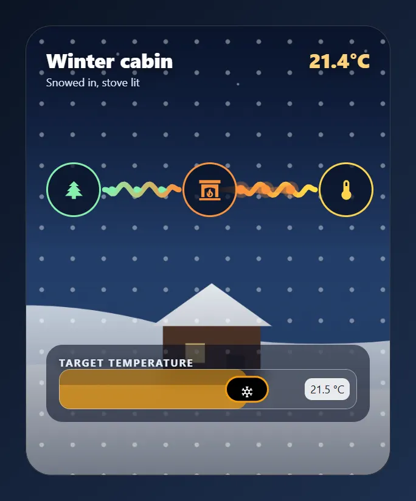

Entities: `sensor.indoor_temperature`, `climate.living_room`, `sensor.solar_power`, `sensor.house_power`

File: [cards/129-winter-cabin.yaml](cards/129-winter-cabin.yaml)

```yaml
# Winter cabin: a snowy night picture slowly zooms behind falling-snow dots and a dark fade. Wave flows carry warmth from the woodpile through the stove to the thermometer, and a Glass slider with blur sets the target temperature.
# Entities: sensor.indoor_temperature, climate.living_room, sensor.solar_power, sensor.house_power
type: custom:magic-card
name: Winter cabin
background: "#0d1b3a"
border_radius: 28px
padding: 22px 22px 58px
box_shadow: "0 20px 44px rgba(0,0,0,0.5)"
pause_button_corner: bottom-right
background_layers:
  - type: pattern
    pattern: dots
    color: "rgba(255,255,255,0.4)"
    size: 34
    thickness: 2
  - type: gradient
    gradient: "linear-gradient(to bottom, rgba(8,16,36,0.65) 0%, rgba(8,16,36,0) 35%, rgba(8,16,36,0.55) 100%)"
  - type: image
    image: /local/showcase-cabin.svg
    size: cover
    pan_zoom: { from: 100, to: 120, duration: 24, focus: bottom }
rows:
  - id: head
    column_widths: [1fr, auto]
    columns:
      - gap: 2px
        modules:
          - type: text
            text: Winter cabin
            design: { font_size: 22px, font_weight: "800", color: "#ffffff", text_shadow: "0 2px 14px rgba(0,0,0,0.6)" }
          - type: text
            text: "Snowed in, stove lit"
            design: { font_size: 12px, color: "#dbe7f7", text_shadow: "0 2px 10px rgba(0,0,0,0.6)" }
      - vertical_align: start
        modules:
          - type: text
            use_entity: true
            entity: sensor.indoor_temperature
            design: { font_size: 22px, font_weight: "800", color: "#ffd27a", text_shadow: "0 2px 14px rgba(0,0,0,0.6)" }
  - id: nodes
    column_widths: [56px, 1fr, 56px, 1fr, 56px]
    padding: 70px 0 0
    columns:
      - vertical_align: center
        modules:
          - id: a
            type: icon
            icon: mdi:pine-tree
            size: 26px
            design: { color: "#86efac", width: 56px, height: 56px, display: flex, align_items: center, justify_content: center, border_radius: 50%, border: "2px solid #86efac", background_color: "rgba(8,16,36,0.72)" }
      - modules: []
      - vertical_align: center
        modules:
          - id: b
            type: icon
            icon: mdi:fireplace
            size: 28px
            design: { color: "#fb923c", width: 56px, height: 56px, display: flex, align_items: center, justify_content: center, border_radius: 50%, border: "2px solid #fb923c", background_color: "rgba(8,16,36,0.72)" }
      - modules: []
      - vertical_align: center
        modules:
          - id: c
            type: icon
            icon: mdi:thermometer
            size: 26px
            design: { color: "#fcd34d", width: 56px, height: 56px, display: flex, align_items: center, justify_content: center, border_radius: 50%, border: "2px solid #fcd34d", background_color: "rgba(8,16,36,0.72)" }
  - id: heat
    padding: 130px 0 0
    columns:
      - gap: 0px
        design: { background_color: "rgba(8,16,36,0.6)", border_radius: 18px, padding: 12px 14px 14px }
        modules:
          - type: text
            text: Target temperature
            design: { font_size: 11px, font_weight: "700", color: "#e6eefb", text_transform: uppercase, letter_spacing: 1.5px, text_shadow: "0 2px 8px rgba(0,0,0,0.7)" }
          - type: slider
            entity: climate.living_room
            track_style: glass
            track_thickness: 44
            glass_blur: true
            thumb: pill
            thumb_size: 44
            thumb_icon: mdi:snowflake
            value_position: track
            slider_color: "#f59e0b"
flows:
  - { id: a-b, from: a, to: b, from_anchor: box, to_anchor: box, entity: sensor.solar_power, max: 5000, route: straight, color: "#86efac", color_to: "#fb923c", line_style: wave, width: 3, amplitude: 6, wavelength: 28, shape: drop, dot_size: 9, dots: 3 }
  - { id: b-c, from: b, to: c, from_anchor: box, to_anchor: box, entity: sensor.house_power, max: 2500, route: straight, color: "#fb923c", color_to: "#fde047", line_style: wave, width: 3, amplitude: 6, wavelength: 28, shape: comet, dot_size: 10, dots: 3, glow: 4, arrival: ring, arrival_size: 36 }
```

## Haunted attic

Two tiles with the same hill picture blended in different modes, and Darken behind text on the right one. A neon flow sends a ghost across, and a neon slider sets the spookiness.

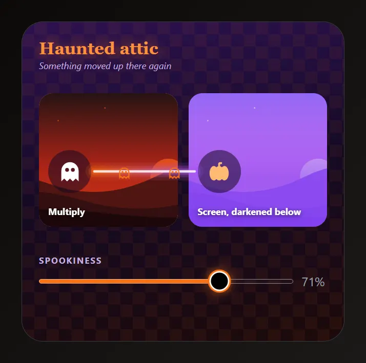

Entities: `light.living_room`

File: [cards/130-haunted-attic.yaml](cards/130-haunted-attic.yaml)

```yaml
# Haunted attic: two tiles with the same hill picture blended in different modes, and Darken behind text on the right one. A neon flow sends a ghost across, and a neon slider sets the spookiness.
# Entities: light.living_room
type: custom:magic-card
name: Haunted attic
background: "#150a24"
border_radius: 28px
padding: 22px 22px 58px
box_shadow: "0 20px 44px rgba(0,0,0,0.55)"
pause_button_corner: bottom-right
background_layers:
  - type: pattern
    pattern: checks
    color: "rgba(249,115,22,0.06)"
    size: 32
    thickness: 2
  - type: gradient
    gradient: "linear-gradient(170deg, #2d1250 0%, #150a24 60%, #1c0a0a 100%)"
rows:
  - id: head
    columns:
      - gap: 2px
        modules:
          - type: text
            text: Haunted attic
            design: { font_size: 22px, font_weight: "800", color: "#fb923c", font_family: "Georgia, 'Times New Roman', serif", text_shadow: "0 0 14px rgba(249,115,22,0.5)" }
          - type: text
            text: "Something moved up there again"
            design: { font_size: 12px, color: "#c4b0e0", font_style: italic }
  - id: tiles
    column_widths: [1fr, 1fr]
    gap: 14px
    padding: 18px 0 0
    columns:
      - vertical_align: end
        design: { background_color: "#e0572b", border_radius: 18px, min_height: 150px, padding: 12px }
        modules:
          - type: image
            image: /local/hills.svg
            placement: background
            layer: { blend: multiply }
          - id: a
            type: icon
            icon: mdi:ghost
            size: 30px
            design: { color: "#ffffff", width: 56px, height: 56px, display: flex, align_items: center, justify_content: center, border_radius: 50%, background_color: "rgba(21,10,36,0.55)", margin_bottom: 8px }
          - type: text
            text: Multiply
            design: { font_size: 12px, font_weight: "700", color: "#ffffff", text_shadow: "0 1px 6px rgba(0,0,0,0.7)" }
      - vertical_align: end
        design: { background_color: "#7c3aed", border_radius: 18px, min_height: 150px, padding: 12px }
        modules:
          - type: image
            image: /local/hills.svg
            placement: background
            layer:
              blend: screen
              scrim: { style: bottom, strength: 65, color: black }
          - id: b
            type: icon
            icon: mdi:pumpkin
            size: 30px
            design: { color: "#fdba74", width: 56px, height: 56px, display: flex, align_items: center, justify_content: center, border_radius: 50%, background_color: "rgba(21,10,36,0.55)", margin_bottom: 8px }
          - type: text
            text: Screen, darkened below
            design: { font_size: 12px, font_weight: "700", color: "#ffffff", text_shadow: "0 1px 6px rgba(0,0,0,0.7)" }
  - id: spook
    padding: 26px 0 0
    columns:
      - gap: 0px
        modules:
          - type: text
            text: Spookiness
            design: { font_size: 11px, font_weight: "700", color: "#c4b0e0", text_transform: uppercase, letter_spacing: 1.5px }
          - type: slider
            entity: light.living_room
            track_style: thin
            track_thickness: 6
            thumb: circle
            thumb_size: 26
            thumb_glow: 14
            thumb_border: 2
            thumb_border_color: "#fff7ed"
            slider_color: "#f97316"
            track_color: "rgba(255,255,255,0.12)"
            value_position: beside
flows:
  - { id: a-b, from: a, to: b, from_anchor: box, to_anchor: box, route: curve, layer: front, color: "#f97316", color_to: "#a855f7", line_style: neon, width: 3, glow: 10, flicker: strong, shape: icon, shape_icon: "mdi:ghost-outline", dot_size: 18, dots: 2, arrival: splash, arrival_size: 44 }
```

## Synthwave deck

A retro sunset picture over a magenta gradient, a neon wave flow with music notes from the deck to the speaker, and a Neon slider for the volume.

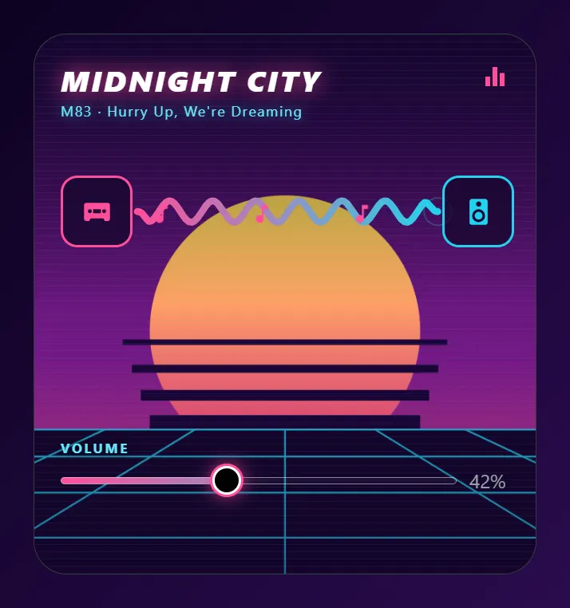

Entities: `media_player.living_room`, `sensor.house_power`

File: [cards/131-synthwave-deck.yaml](cards/131-synthwave-deck.yaml)

```yaml
# Synthwave deck: a retro sunset picture over a magenta gradient, a neon wave flow with music notes from the deck to the speaker, and a Neon slider for the volume.
# Entities: media_player.living_room, sensor.house_power
type: custom:magic-card
name: Synthwave deck
background: "#14052b"
border_radius: 28px
padding: 22px 22px 58px
box_shadow: "0 20px 44px rgba(0,0,0,0.55)"
pause_button_corner: bottom-right
background_layers:
  - type: pattern
    pattern: lines
    color: "rgba(34,211,238,0.07)"
    size: 6
    thickness: 1
  - type: gradient
    gradient: "linear-gradient(to bottom, rgba(20,5,43,0.7) 0%, rgba(20,5,43,0) 40%, rgba(20,5,43,0.35) 100%)"
  - type: image
    image: /local/showcase-synth.svg
    size: cover
    pan_zoom: { from: 100, to: 112, duration: 28, focus: bottom }
rows:
  - id: head
    column_widths: [1fr, auto]
    columns:
      - gap: 2px
        modules:
          - type: text
            text: Midnight City
            design: { font_size: 24px, font_weight: "800", color: "#ffffff", font_style: italic, text_transform: uppercase, letter_spacing: 2px, text_shadow: "0 0 18px rgba(255,79,154,0.9)" }
          - type: text
            text: "M83 · Hurry Up, We're Dreaming"
            design: { font_size: 12px, color: "#67e8f9", letter_spacing: 1px, text_shadow: "0 0 10px rgba(34,211,238,0.7)" }
      - vertical_align: start
        modules:
          - type: icon
            icon: mdi:equalizer
            size: 24px
            design: { color: "#ff4f9a" }
  - id: chain
    column_widths: [56px, 1fr, 56px]
    padding: 36px 0 0
    columns:
      - vertical_align: center
        modules:
          - id: a
            type: icon
            icon: mdi:cassette
            size: 26px
            design: { color: "#ff4f9a", width: 56px, height: 56px, display: flex, align_items: center, justify_content: center, border_radius: 14px, border: "2px solid #ff4f9a", background_color: "rgba(20,5,43,0.72)" }
      - modules: []
      - vertical_align: center
        modules:
          - id: b
            type: icon
            icon: mdi:speaker
            size: 26px
            design: { color: "#22d3ee", width: 56px, height: 56px, display: flex, align_items: center, justify_content: center, border_radius: 14px, border: "2px solid #22d3ee", background_color: "rgba(20,5,43,0.72)" }
  - id: vol
    padding: 150px 0 0
    columns:
      - gap: 0px
        modules:
          - type: text
            text: Volume
            design: { font_size: 11px, font_weight: "700", color: "#67e8f9", text_transform: uppercase, letter_spacing: 2px, text_shadow: "0 0 8px rgba(0,0,0,0.9)" }
          - type: slider
            entity: media_player.living_room
            track_style: thin
            track_thickness: 6
            thumb: circle
            thumb_size: 24
            thumb_glow: 16
            thumb_border: 2
            thumb_border_color: "#ffffff"
            slider_color: "#ff4f9a"
            slider_color_to: "#22d3ee"
            fill_mode: gradient
            track_color: "rgba(255,255,255,0.18)"
            value_position: beside
flows:
  - { id: a-b, from: a, to: b, from_anchor: box, to_anchor: box, entity: sensor.house_power, max: 2000, route: straight, color: "#ff4f9a", color_to: "#22d3ee", line_style: wave, width: 3, amplitude: 9, wavelength: 36, glow: 8, shape: icon, shape_icon: "mdi:music-note", shape_icon_rotate: false, dot_size: 20, dots: 3, arrival: ring, arrival_size: 40 }
```

## Reef tank

A reef picture slowly zooms behind a blue fade. Glass tubes with bubbles carry the water from the pump through the filter into the tank, the level following the value, and a wave-shaped Big fill slider dims the reef light.

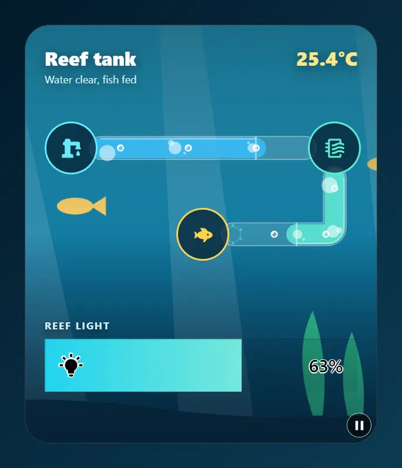

Entities: `sensor.home_battery`, `sensor.house_power`, `sensor.aquarium_temperature`, `light.garden`

File: [cards/132-reef-tank.yaml](cards/132-reef-tank.yaml)

```yaml
# Reef tank: a reef picture slowly zooms behind a blue fade. Glass tubes with bubbles carry the water from the pump through the filter into the tank, the level following the value, and a wave-shaped Big fill slider dims the reef light.
# Entities: sensor.home_battery, sensor.house_power, sensor.aquarium_temperature, light.garden
type: custom:magic-card
name: Reef tank
background: "#06304a"
border_radius: 28px
padding: 22px 22px 58px
box_shadow: "0 20px 44px rgba(0,0,0,0.5)"
pause_button_corner: bottom-right
background_layers:
  - type: gradient
    gradient: "linear-gradient(to bottom, rgba(6,48,74,0.55) 0%, rgba(6,48,74,0) 40%, rgba(3,26,43,0.6) 100%)"
  - type: image
    image: /local/showcase-reef.svg
    size: cover
    pan_zoom: { from: 100, to: 118, duration: 26, focus: center }
rows:
  - id: head
    column_widths: [1fr, auto]
    columns:
      - gap: 2px
        modules:
          - type: text
            text: Reef tank
            design: { font_size: 22px, font_weight: "800", color: "#ffffff", text_shadow: "0 2px 14px rgba(0,0,0,0.5)" }
          - type: text
            text: "Water clear, fish fed"
            design: { font_size: 12px, color: "#d4f1fb", text_shadow: "0 2px 10px rgba(0,0,0,0.5)" }
      - vertical_align: start
        modules:
          - type: text
            use_entity: true
            entity: sensor.aquarium_temperature
            design: { font_size: 22px, font_weight: "800", color: "#fde68a", text_shadow: "0 2px 14px rgba(0,0,0,0.5)" }
  - id: top
    column_widths: [56px, 1fr, 56px]
    padding: 30px 0 0
    columns:
      - vertical_align: center
        modules:
          - id: a
            type: icon
            icon: mdi:water-pump
            size: 26px
            design: { color: "#67e8f9", width: 56px, height: 56px, display: flex, align_items: center, justify_content: center, border_radius: 50%, border: "2px solid #67e8f9", background_color: "rgba(3,26,43,0.72)" }
      - modules: []
      - vertical_align: center
        modules:
          - id: b
            type: icon
            icon: mdi:air-filter
            size: 26px
            design: { color: "#5eead4", width: 56px, height: 56px, display: flex, align_items: center, justify_content: center, border_radius: 50%, border: "2px solid #5eead4", background_color: "rgba(3,26,43,0.72)" }
  - id: bottom
    column_widths: [1fr, 56px, 1fr]
    padding: 28px 0 0
    columns:
      - modules: []
      - vertical_align: center
        modules:
          - id: c
            type: icon
            icon: mdi:fish
            size: 26px
            design: { color: "#fcd34d", width: 56px, height: 56px, display: flex, align_items: center, justify_content: center, border_radius: 50%, border: "2px solid #fcd34d", background_color: "rgba(3,26,43,0.72)" }
      - modules: []
  - id: light
    padding: 56px 0 0
    columns:
      - gap: 8px
        modules:
          - type: text
            text: Reef light
            design: { font_size: 11px, font_weight: "700", color: "#d4f1fb", text_transform: uppercase, letter_spacing: 1.5px, text_shadow: "0 2px 8px rgba(0,0,0,0.7)" }
          - type: slider
            entity: light.garden
            track_shape: wave
            track_style: big-fill
            track_thickness: 60
            thumb: none
            value_position: track
            fill_mode: gradient
            slider_color: "#22d3ee"
            slider_color_to: "#a7f3d0"
            track_color: "rgba(3,26,43,0.5)"
            icon: mdi:lightbulb-on
flows:
  - { id: a-b, from: a, to: b, from_anchor: box, to_anchor: box, entity: sensor.home_battery, max: 100, route: straight, color: "#38bdf8", line_style: tube, width: 14, bubble_count: 6, tube_fill_value: true, tube_tint: "rgba(255,255,255,0.14)", shape: bubble, dot_size: 8, dots: 3 }
  - { id: b-c, from: b, to: c, from_anchor: box, to_anchor: box, entity: sensor.house_power, max: 2000, route: elbow, from_side: bottom, to_side: right, color: "#5eead4", line_style: tube, width: 14, bubble_count: 5, tube_fill_value: true, tube_tint: "rgba(255,255,255,0.14)", shape: bubble, dot_size: 8, dots: 3, arrival: splash, arrival_size: 36 }
```

## Station oxygen

A nebula picture drifts behind a star pattern. Tubes carry the air from the tank through the hub to the crew deck with the level following the value, and a segmented fan slider with a badge on top shows the circulation.

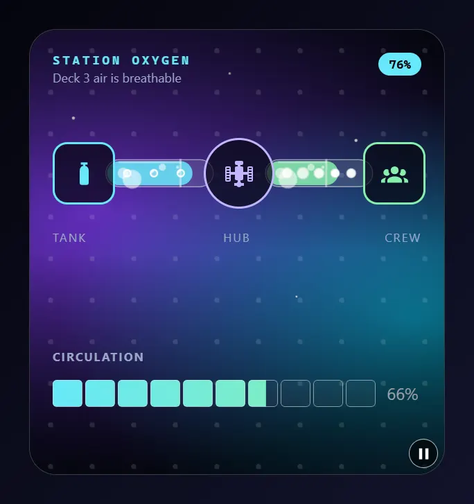

Entities: `sensor.home_battery`, `sensor.house_power`, `fan.bedroom`

File: [cards/133-station-oxygen.yaml](cards/133-station-oxygen.yaml)

```yaml
# Station oxygen: a nebula picture drifts behind a star pattern. Tubes carry the air from the tank through the hub to the crew deck with the level following the value, and a segmented fan slider with a badge on top shows the circulation.
# Entities: sensor.home_battery, sensor.house_power, fan.bedroom
type: custom:magic-card
name: Station oxygen
background: "#05060f"
border_radius: 26px
padding: 22px 22px 58px
box_shadow: "0 20px 44px rgba(0,0,0,0.6)"
pause_button_corner: bottom-right
background_layers:
  - type: pattern
    pattern: dots
    color: "rgba(255,255,255,0.12)"
    size: 40
    thickness: 2
  - type: gradient
    gradient: "linear-gradient(to bottom, rgba(5,6,15,0.5) 0%, rgba(5,6,15,0) 50%, rgba(5,6,15,0.55) 100%)"
  - type: image
    image: /local/showcase-nebula.svg
    size: cover
    pan_zoom: { from: 100, to: 130, duration: 30, focus: center }
rows:
  - id: head
    column_widths: [1fr, auto]
    columns:
      - gap: 2px
        modules:
          - type: text
            text: Station oxygen
            design: { font_size: 12px, font_weight: "700", color: "#67e8f9", text_transform: uppercase, letter_spacing: 2.5px, font_family: "ui-monospace, 'Cascadia Mono', Menlo, monospace" }
          - type: text
            text: "Deck 3 air is breathable"
            design: { font_size: 12px, color: "#9aa7c7" }
      - vertical_align: start
        modules:
          - type: text
            use_entity: true
            entity: sensor.home_battery
            placement: overlay
            layer: { anchor: top-right }
            design: { font_size: 12px, font_weight: "800", color: "#05060f", padding: 4px 10px, border_radius: 999px, background_color: "#67e8f9", font_family: "ui-monospace, 'Cascadia Mono', Menlo, monospace" }
  - id: chain
    column_widths: [56px, 1fr, 64px, 1fr, 56px]
    padding: 40px 0 0
    columns:
      - vertical_align: center
        modules:
          - id: a
            type: icon
            icon: mdi:gas-cylinder
            size: 26px
            design: { color: "#67e8f9", width: 56px, height: 56px, display: flex, align_items: center, justify_content: center, border_radius: 14px, border: "2px solid #67e8f9", background_color: "rgba(5,6,15,0.7)" }
      - modules: []
      - vertical_align: center
        modules:
          - id: b
            type: icon
            icon: mdi:space-station
            size: 32px
            design: { color: "#c4b5fd", width: 64px, height: 64px, display: flex, align_items: center, justify_content: center, border_radius: 50%, border: "2px solid #c4b5fd", background_color: "rgba(5,6,15,0.7)" }
      - modules: []
      - vertical_align: center
        modules:
          - id: c
            type: icon
            icon: mdi:account-group
            size: 26px
            design: { color: "#86efac", width: 56px, height: 56px, display: flex, align_items: center, justify_content: center, border_radius: 14px, border: "2px solid #86efac", background_color: "rgba(5,6,15,0.7)" }
  - id: labels
    column_widths: [1fr, 1fr, 1fr]
    padding: 10px 0 0
    columns:
      - modules:
          - type: text
            text: Tank
            design: { font_size: 11px, color: "#9aa7c7", text_transform: uppercase, letter_spacing: 1.5px, text_align: left }
      - modules:
          - type: text
            text: Hub
            design: { font_size: 11px, color: "#9aa7c7", text_transform: uppercase, letter_spacing: 1.5px, text_align: center }
      - modules:
          - type: text
            text: Crew
            design: { font_size: 11px, color: "#9aa7c7", text_transform: uppercase, letter_spacing: 1.5px, text_align: right }
  - id: fan
    padding: 90px 0 0
    columns:
      - gap: 8px
        modules:
          - type: text
            text: Circulation
            design: { font_size: 11px, font_weight: "700", color: "#9aa7c7", text_transform: uppercase, letter_spacing: 1.5px }
          - type: slider
            entity: fan.bedroom
            track_style: segmented
            segments: 10
            segment_gap: 3
            track_thickness: 26
            thumb: none
            value_position: beside
            slider_color: "#67e8f9"
            slider_color_to: "#86efac"
            fill_mode: gradient
            track_color: "rgba(255,255,255,0.1)"
flows:
  - { id: a-b, from: a, to: b, from_anchor: box, to_anchor: box, entity: sensor.home_battery, max: 100, route: straight, color: "#67e8f9", line_style: tube, width: 14, bubble_count: 4, tube_fill_value: true, tube_tint: "rgba(255,255,255,0.12)", shape: bubble, dot_size: 8, dots: 3 }
  - { id: b-c, from: b, to: c, from_anchor: box, to_anchor: box, entity: sensor.house_power, max: 2000, route: straight, color: "#86efac", line_style: tube, width: 14, bubble_count: 4, tube_fill_value: true, tube_tint: "rgba(255,255,255,0.12)", motion: pulse, dots: 5, dot_size: 8, shape: dot }
```

## Steam boiler

Twisted brass cables with turning cogs carry the heat from the firebox to the boiler and out to the radiators, with a splash of steam on arrival. Darken behind text fades a glowing picture behind the title, and a notch-shaped Big fill slider with stops sets the valve.

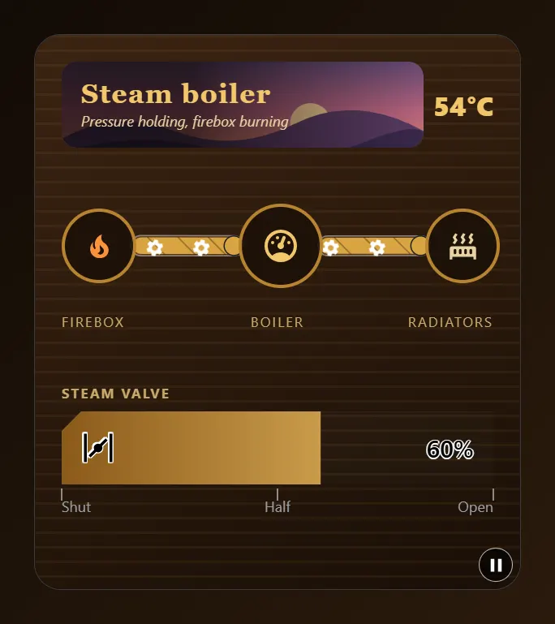

Entities: `sensor.solar_power`, `sensor.house_power`, `sensor.boiler_temperature`, `cover.living_blinds`

File: [cards/134-steam-boiler.yaml](cards/134-steam-boiler.yaml)

```yaml
# Steam boiler: twisted brass cables with turning cogs carry the heat from the firebox to the boiler and out to the radiators, with a splash of steam on arrival. Darken behind text fades a glowing picture behind the title, and a notch-shaped Big fill slider with stops sets the valve.
# Entities: sensor.solar_power, sensor.house_power, sensor.boiler_temperature, cover.living_blinds
type: custom:magic-card
name: Steam boiler
background: "#1a0f07"
border_radius: 22px
padding: 22px 22px 58px
box_shadow: "0 20px 44px rgba(0,0,0,0.6)"
pause_button_corner: bottom-right
background_layers:
  - type: pattern
    pattern: lines
    color: "rgba(217,164,65,0.07)"
    size: 12
    thickness: 2
  - type: gradient
    gradient: "linear-gradient(160deg, #3b2412 0%, #1a0f07 70%)"
rows:
  - id: head
    column_widths: [1fr, auto]
    columns:
      - gap: 2px
        design: { padding: 14px 16px, border_radius: 12px, overflow: hidden, position: relative }
        modules:
          - type: image
            image: /local/hills.svg
            placement: background
            layer:
              opacity: 90
              scrim: { style: left, strength: 70, color: black }
          - type: text
            text: Steam boiler
            design: { font_size: 22px, font_weight: "800", color: "#f3c76b", font_family: "Georgia, 'Times New Roman', serif", letter_spacing: 1px }
          - type: text
            text: "Pressure holding, firebox burning"
            design: { font_size: 12px, color: "#e8d3a6", font_style: italic }
      - vertical_align: center
        modules:
          - type: text
            use_entity: true
            entity: sensor.boiler_temperature
            design: { font_size: 22px, font_weight: "800", color: "#f3c76b", text_align: right }
  - id: chain
    column_widths: [56px, 1fr, 64px, 1fr, 56px]
    padding: 36px 0 0
    columns:
      - vertical_align: center
        modules:
          - id: a
            type: icon
            icon: mdi:fire
            size: 26px
            design: { color: "#fb923c", width: 56px, height: 56px, display: flex, align_items: center, justify_content: center, border_radius: 50%, border: "3px solid #b8832e", background_color: "rgba(26,15,7,0.85)" }
      - modules: []
      - vertical_align: center
        modules:
          - id: b
            type: icon
            icon: mdi:gauge
            size: 32px
            design: { color: "#f3c76b", width: 64px, height: 64px, display: flex, align_items: center, justify_content: center, border_radius: 50%, border: "3px solid #b8832e", background_color: "rgba(26,15,7,0.85)" }
      - modules: []
      - vertical_align: center
        modules:
          - id: c
            type: icon
            icon: mdi:radiator
            size: 26px
            design: { color: "#e8d3a6", width: 56px, height: 56px, display: flex, align_items: center, justify_content: center, border_radius: 50%, border: "3px solid #b8832e", background_color: "rgba(26,15,7,0.85)" }
  - id: labels
    column_widths: [1fr, 1fr, 1fr]
    padding: 10px 0 0
    columns:
      - modules:
          - type: text
            text: Firebox
            design: { font_size: 11px, color: "#c9a96a", text_transform: uppercase, letter_spacing: 1.5px, text_align: left }
      - modules:
          - type: text
            text: Boiler
            design: { font_size: 11px, color: "#c9a96a", text_transform: uppercase, letter_spacing: 1.5px, text_align: center }
      - modules:
          - type: text
            text: Radiators
            design: { font_size: 11px, color: "#c9a96a", text_transform: uppercase, letter_spacing: 1.5px, text_align: right }
  - id: valve
    padding: 34px 0 0
    columns:
      - gap: 8px
        modules:
          - type: text
            text: Steam valve
            design: { font_size: 11px, font_weight: "700", color: "#c9a96a", text_transform: uppercase, letter_spacing: 1.5px }
          - type: slider
            entity: cover.living_blinds
            track_shape: notch
            track_style: big-fill
            track_thickness: 60
            thumb: none
            value_position: track
            fill_mode: gradient
            slider_color: "#8a5a1a"
            slider_color_to: "#f3c76b"
            track_color: "rgba(255,255,255,0.07)"
            icon: mdi:valve
            snap: true
            stops: [{ value: 0, label: Shut }, { value: 50, label: Half }, { value: 100, label: Open }]
flows:
  - { id: a-b, from: a, to: b, from_anchor: box, to_anchor: box, entity: sensor.solar_power, max: 5000, route: straight, color: "#d9a441", line_style: cable, width: 8, twisted: true, cable_color: "#5b3a1a", shape: icon, shape_icon: "mdi:cog", shape_spin: true, shape_icon_rotate: false, dot_size: 16, dots: 2, end_cap: round }
  - { id: b-c, from: b, to: c, from_anchor: box, to_anchor: box, entity: sensor.house_power, max: 2500, route: straight, color: "#d9a441", line_style: cable, width: 8, twisted: true, cable_color: "#5b3a1a", shape: icon, shape_icon: "mdi:cog", shape_spin: true, shape_icon_rotate: false, dot_size: 16, dots: 2, arrival: splash, arrival_size: 40, end_cap: round }
```
