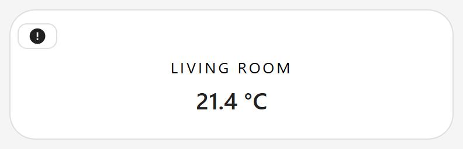
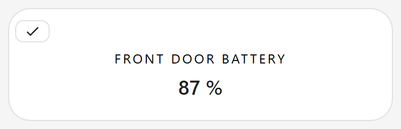
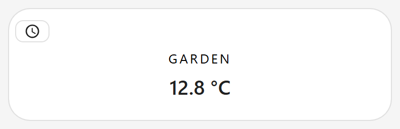

# Is this still true?

A card shows the last thing Home Assistant told it. When that may be out of date, Magic Card says so with a small icon in the top-left corner of the card; tap it to read the full sentence. Nothing moves, the values stay as they are, and the card keeps its size. Paste a card into the code editor of a new card, then change the entity ids to your own. Back to the [gallery](README.md).

## Cards

-   [Connection lost](#connection-lost)
-   [Reconnected](#reconnected)
-   [Not updated](#not-updated)

## Connection lost

When the browser cannot reach Home Assistant for fifteen seconds, the icon names the time the connection dropped. A shorter drop shows nothing, so a Wi-Fi hop does not flash a warning.



Entities: `sensor.living_room_temperature`

The card asks for the on-demand part that draws the icon only when it is needed. A card with no `quiet_time` loads it only when the connection first drops, so a card that never loses its connection does not fetch it. The editor preview never shows this face, because the editor has its own connection message.

```yaml
# Connection lost: a living room reading that says so when Home Assistant cannot be reached for fifteen seconds.
# Entities: sensor.living_room_temperature
# gallery: width=380
type: custom:magic-card
name: Connection lost
border_radius: 22px
padding: 40px 20px 20px
rows:
  - id: main
    columns:
      - modules:
          - type: vertical
            gap: 6px
            align: center
            justify: center
            modules:
              - type: text
                text: Living room
                design: { font_size: 13px, text_transform: uppercase, letter_spacing: 2px }
              - type: info
                entity: sensor.living_room_temperature
                quiet_time: "1:00:00"
                show_name: false
                show_unit: true
                design: { font_size: 44px, font_weight: "300" }
```

## Reconnected

Once Home Assistant answers again after an icon like the one above, the icon says so for three seconds and then goes. A connection that came back before the first strip appeared shows nothing.



Entities: `sensor.front_door_battery`

The full sentence sits in a polite live region, so a screen reader announces each change once.

```yaml
# Reconnected: a door reading that shows one short word once Home Assistant answers again.
# Entities: sensor.front_door_battery
# gallery: width=380
type: custom:magic-card
name: Reconnected
border_radius: 22px
padding: 40px 20px 20px
rows:
  - id: main
    columns:
      - modules:
          - type: vertical
            gap: 6px
            align: center
            justify: center
            modules:
              - type: text
                text: Front door battery
                design: { font_size: 13px, text_transform: uppercase, letter_spacing: 2px }
              - type: info
                entity: sensor.front_door_battery
                quiet_time: "1:00:00"
                show_name: false
                show_unit: true
                design: { font_size: 44px, font_weight: "300" }
```

## Not updated

A sensor that has not reported for as long as its `quiet_time` gets the icon with the time of its last update. Write `quiet_time` as `H:MM:SS` or as a number of seconds, on the same node as the `entity` it belongs to. A value that cannot be read makes the card report an invalid configuration, so a typo never hides the icon silently.



Entities: `sensor.garden_temperature`

With several quiet entities the icon shows the oldest time. It also shows in the editor preview, so you can see `quiet_time` work. The time follows your Home Assistant language and time format.

```yaml
# Not updated: a garden reading that names the time it last reported once it has been quiet for ten minutes.
# Entities: sensor.garden_temperature
# gallery: width=380
type: custom:magic-card
name: Not updated
border_radius: 22px
padding: 40px 20px 20px
rows:
  - id: main
    columns:
      - modules:
          - type: vertical
            gap: 6px
            align: center
            justify: center
            modules:
              - type: text
                text: Garden
                design: { font_size: 13px, text_transform: uppercase, letter_spacing: 2px }
              - type: info
                entity: sensor.garden_temperature
                quiet_time: "0:10:00"
                show_name: false
                show_unit: true
                design: { font_size: 44px, font_weight: "300" }
```

## Which icon shows first

1.  Connection lost.
2.  Reconnected.
3.  Not updated since.

The icon takes the card background and text colour of your theme. The text keeps at least 4.5:1 contrast in light and in dark.

## Related

-   [Loading and size](../loading-and-size/README.md): what loads on demand and what a card shows when a part cannot load
