# Wall tablet cards

Four big status cards for a wall tablet: the front door, the kitchen door, the hallway lights and the alarm. Each icon swaps with the state and the state is a single large word. Paste a card into the code editor of a new card, then change the entity ids to your own. Back to the [gallery](README.md).

## Cards

-   [Front door](#front-door)
-   [Kitchen door](#kitchen-door)
-   [Hallway lights](#hallway-lights)
-   [Alarm](#alarm)

## Front door

A big door icon that swaps between closed and open, the word for the state and when it last changed. The icon pulses softly while the door is open.

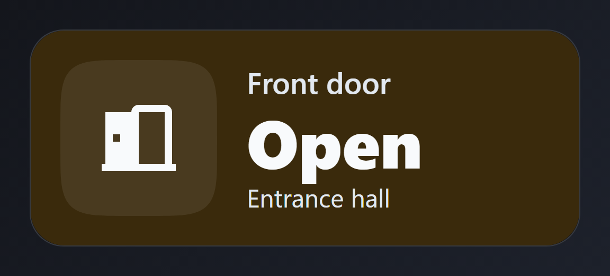

The open state.

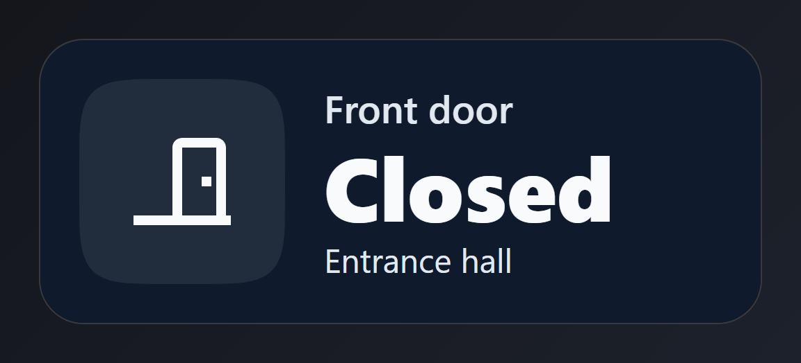

The closed state.


The open state with its motion paused.

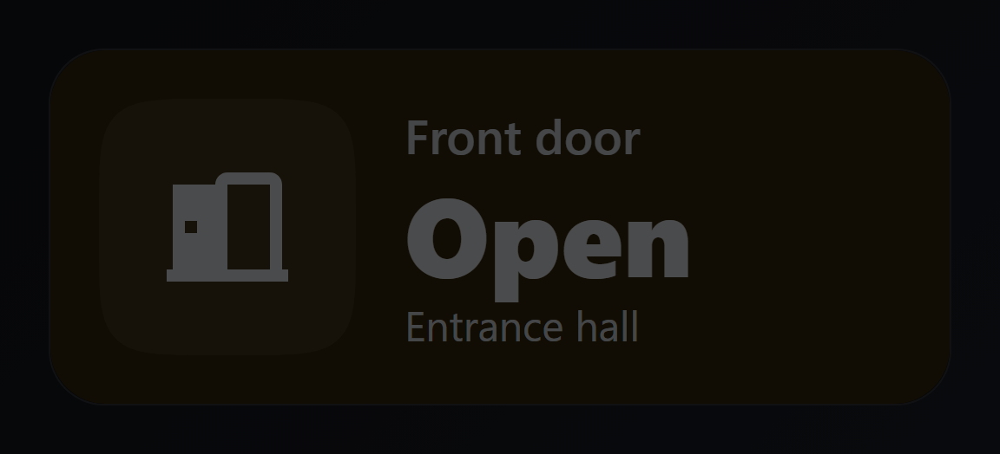

The paused picture at 30 % brightness. The dimming is simulated with a filter on the picture; the card itself does not change.

Entities: `binary_sensor.front_door`

Nothing on the card is tappable: tap, hold and double tap are `none` on the card and on every module, so a touch on the wall tablet never opens a dialog. The icon pulses softly while the door is open.

File: [cards/141-front-door.yaml](cards/141-front-door.yaml)

```yaml
# Front door: a big door icon that swaps between closed and open, the word for the state and when it last changed. The icon pulses softly while the door is open.
# Entities: binary_sensor.front_door
type: custom:magic-card
name: Front door
background: "#0f1b2d"
border_radius: 32px
padding: 28px
box_shadow: "0 18px 40px rgba(0,0,0,0.45)"
conditional_appearance:
  - id: active
    name: Active
    conditions: [{ type: state, entity: binary_sensor.front_door, state: "on" }]
    overrides:
      background: "#3a2a0c"
rows:
  - id: main
    column_widths: [auto, 1fr]
    gap: 28px
    actions: { tap_action: { action: none }, hold_action: { action: none }, double_tap_action: { action: none } }
    columns:
      - vertical_align: center
        modules:
          - type: icon
            entity: binary_sensor.front_door
            icon_on: mdi:door-open
            icon_off: mdi:door-closed
            icon: mdi:door-closed
            size: 84px
            actions: { tap_action: { action: none }, hold_action: { action: none }, double_tap_action: { action: none } }
            design:
              color: "#f8fafc"
              width: 148px
              height: 148px
              display: flex
              align_items: center
              justify_content: center
              shape: squircle
              background: "rgba(255,255,255,0.08)"
              animations: [{ preset: fade-pulse, trigger: entity_on, duration: 3s, intensity: 25 }]
      - vertical_align: center
        gap: 4px
        modules:
          - type: text
            text: Front door
            actions: { tap_action: { action: none }, hold_action: { action: none }, double_tap_action: { action: none } }
            design: { font_size: 28px, color: "#e2e8f0", font_weight: "600" }
          - type: text
            use_entity: true
            entity: binary_sensor.front_door
            actions: { tap_action: { action: none }, hold_action: { action: none }, double_tap_action: { action: none } }
            design: { font_size: 64px, line_height: "1.05", font_weight: "800", color: "#f8fafc" }
          - type: text
            text: Entrance hall
            actions: { tap_action: { action: none }, hold_action: { action: none }, double_tap_action: { action: none } }
            design: { font_size: 24px, color: "#e2e8f0" }
```

## Kitchen door

A big door icon that swaps between closed and open, the word for the state and when it last changed. Nothing moves.

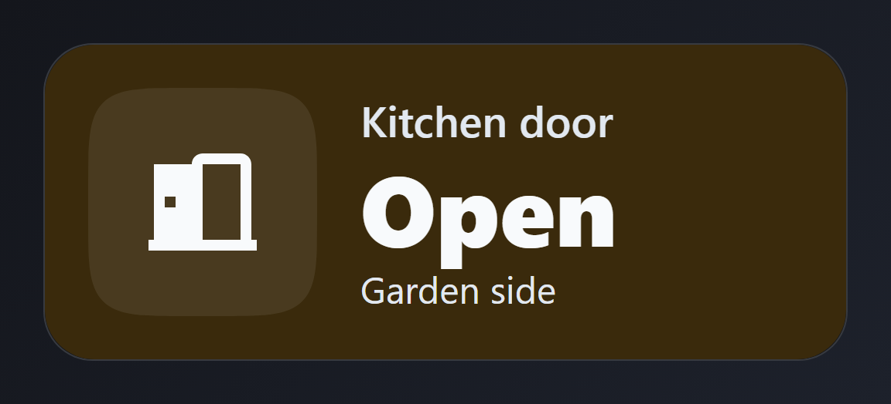

The open state.

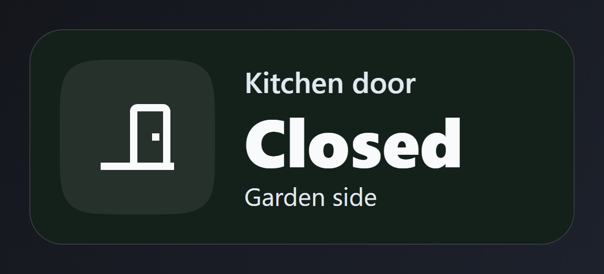

The closed state.


The open state with its motion paused.

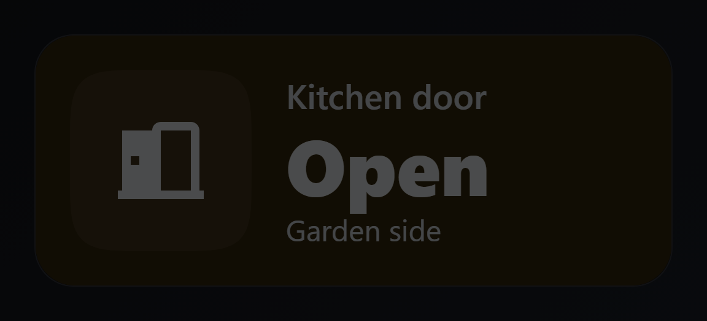

The paused picture at 30 % brightness. The dimming is simulated with a filter on the picture; the card itself does not change.

Entities: `binary_sensor.kitchen_door`

Nothing on the card is tappable (`tap_action: none`). The state word and the icon follow `binary_sensor.kitchen_door`.

File: [cards/142-kitchen-door.yaml](cards/142-kitchen-door.yaml)

```yaml
# Kitchen door: a big door icon that swaps between closed and open, the word for the state and when it last changed. Nothing moves.
# Entities: binary_sensor.kitchen_door
type: custom:magic-card
name: Kitchen door
background: "#14201a"
border_radius: 32px
padding: 28px
box_shadow: "0 18px 40px rgba(0,0,0,0.45)"
conditional_appearance:
  - id: active
    name: Active
    conditions: [{ type: state, entity: binary_sensor.kitchen_door, state: "on" }]
    overrides:
      background: "#3a2a0c"
rows:
  - id: main
    column_widths: [auto, 1fr]
    gap: 28px
    actions: { tap_action: { action: none }, hold_action: { action: none }, double_tap_action: { action: none } }
    columns:
      - vertical_align: center
        modules:
          - type: icon
            entity: binary_sensor.kitchen_door
            icon_on: mdi:door-open
            icon_off: mdi:door-closed
            icon: mdi:door-closed
            size: 84px
            actions: { tap_action: { action: none }, hold_action: { action: none }, double_tap_action: { action: none } }
            design:
              color: "#f8fafc"
              width: 148px
              height: 148px
              display: flex
              align_items: center
              justify_content: center
              shape: squircle
              background: "rgba(255,255,255,0.08)"
      - vertical_align: center
        gap: 4px
        modules:
          - type: text
            text: Kitchen door
            actions: { tap_action: { action: none }, hold_action: { action: none }, double_tap_action: { action: none } }
            design: { font_size: 28px, color: "#e2e8f0", font_weight: "600" }
          - type: text
            use_entity: true
            entity: binary_sensor.kitchen_door
            actions: { tap_action: { action: none }, hold_action: { action: none }, double_tap_action: { action: none } }
            design: { font_size: 64px, line_height: "1.05", font_weight: "800", color: "#f8fafc" }
          - type: text
            text: Garden side
            actions: { tap_action: { action: none }, hold_action: { action: none }, double_tap_action: { action: none } }
            design: { font_size: 24px, color: "#e2e8f0" }
```

## Hallway lights

A big ceiling light icon that swaps between off and on, the word for the state and the brightness. The icon pulses softly while the lights are on.


The open state.

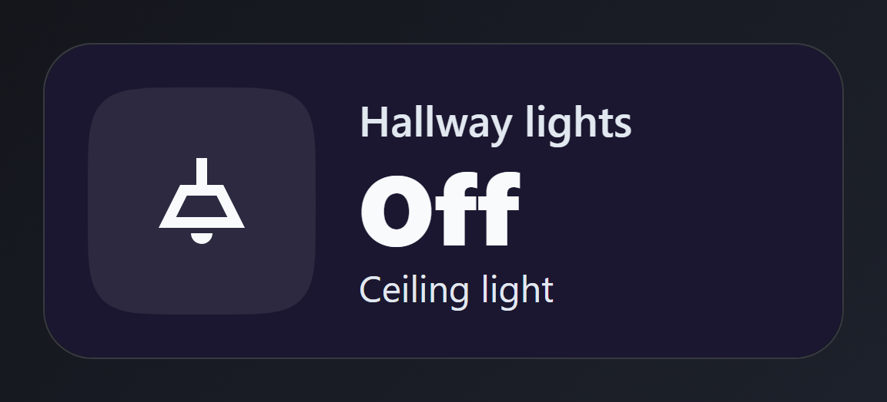

The closed state.

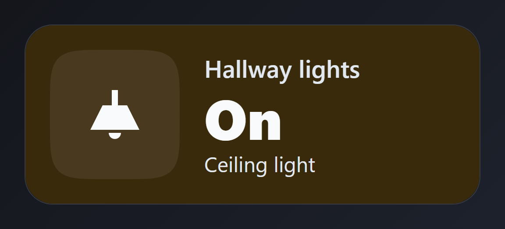

The open state with its motion paused.

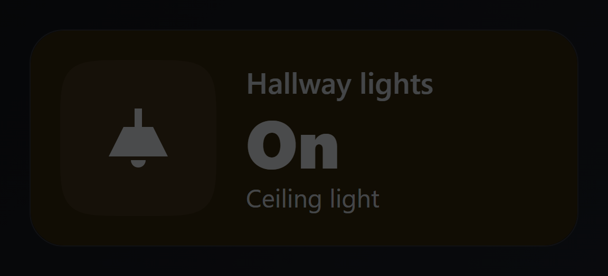

The paused picture at 30 % brightness. The dimming is simulated with a filter on the picture; the card itself does not change.

Entities: `light.hall_ceiling`

Nothing on the card is tappable (`tap_action: none`). The state word and the icon follow `light.hall_ceiling`.

File: [cards/143-hallway-lights.yaml](cards/143-hallway-lights.yaml)

```yaml
# Hallway lights: a big ceiling light icon that swaps between off and on, the word for the state and the brightness. The icon pulses softly while the lights are on.
# Entities: light.hall_ceiling
type: custom:magic-card
name: Hallway lights
background: "#1b1730"
border_radius: 32px
padding: 28px
box_shadow: "0 18px 40px rgba(0,0,0,0.45)"
conditional_appearance:
  - id: active
    name: Active
    conditions: [{ type: state, entity: light.hall_ceiling, state: "on" }]
    overrides:
      background: "#3a2a0c"
rows:
  - id: main
    column_widths: [auto, 1fr]
    gap: 28px
    actions: { tap_action: { action: none }, hold_action: { action: none }, double_tap_action: { action: none } }
    columns:
      - vertical_align: center
        modules:
          - type: icon
            entity: light.hall_ceiling
            icon_on: mdi:ceiling-light
            icon_off: mdi:ceiling-light-outline
            icon: mdi:ceiling-light-outline
            size: 84px
            actions: { tap_action: { action: none }, hold_action: { action: none }, double_tap_action: { action: none } }
            design:
              color: "#f8fafc"
              width: 148px
              height: 148px
              display: flex
              align_items: center
              justify_content: center
              shape: squircle
              background: "rgba(255,255,255,0.08)"
              animations: [{ preset: fade-pulse, trigger: entity_on, duration: 3s, intensity: 25 }]
      - vertical_align: center
        gap: 4px
        modules:
          - type: text
            text: Hallway lights
            actions: { tap_action: { action: none }, hold_action: { action: none }, double_tap_action: { action: none } }
            design: { font_size: 28px, color: "#e2e8f0", font_weight: "600" }
          - type: text
            use_entity: true
            entity: light.hall_ceiling
            actions: { tap_action: { action: none }, hold_action: { action: none }, double_tap_action: { action: none } }
            design: { font_size: 64px, line_height: "1.05", font_weight: "800", color: "#f8fafc" }
          - type: text
            text: Ceiling light
            actions: { tap_action: { action: none }, hold_action: { action: none }, double_tap_action: { action: none } }
            design: { font_size: 24px, color: "#e2e8f0" }
```

## Alarm

A big shield icon that swaps between armed and disarmed, and the word for the state. Nothing moves.

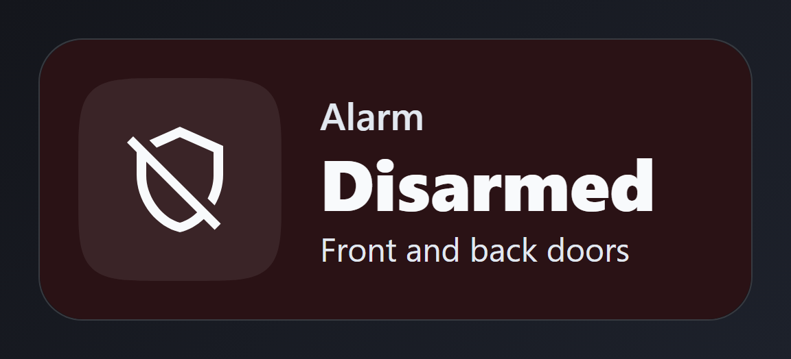

The open state.

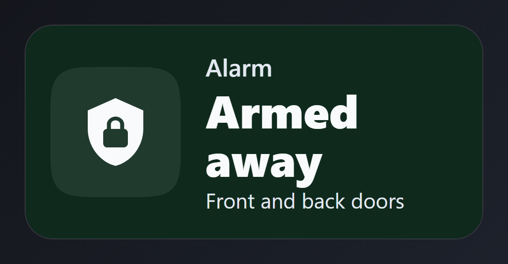

The closed state.


The open state with its motion paused.

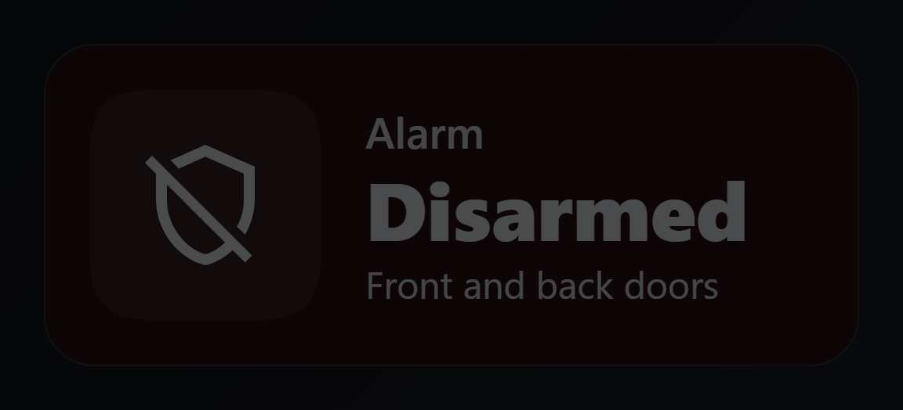

The paused picture at 30 % brightness. The dimming is simulated with a filter on the picture; the card itself does not change.

Entities: `alarm_control_panel.house`

Nothing on the card is tappable (`tap_action: none`). The state word and the icon follow `alarm_control_panel.house`.

File: [cards/144-alarm.yaml](cards/144-alarm.yaml)

```yaml
# Alarm: a big shield icon that swaps between armed and disarmed, and the word for the state. Nothing moves.
# Entities: alarm_control_panel.house
type: custom:magic-card
name: Alarm
background: "#2a1215"
border_radius: 32px
padding: 28px
box_shadow: "0 18px 40px rgba(0,0,0,0.45)"
conditional_appearance:
  - id: active
    name: Active
    conditions: [{ type: state, entity: alarm_control_panel.house, state: armed_away }]
    overrides:
      background: "#0f2a1d"
rows:
  - id: main
    column_widths: [auto, 1fr]
    gap: 28px
    actions: { tap_action: { action: none }, hold_action: { action: none }, double_tap_action: { action: none } }
    columns:
      - vertical_align: center
        modules:
          - type: icon
            entity: alarm_control_panel.house
            icon_on: mdi:shield-lock
            icon_off: mdi:shield-off-outline
            icon: mdi:shield-off-outline
            size: 84px
            actions: { tap_action: { action: none }, hold_action: { action: none }, double_tap_action: { action: none } }
            design:
              color: "#f8fafc"
              width: 148px
              height: 148px
              display: flex
              align_items: center
              justify_content: center
              shape: squircle
              background: "rgba(255,255,255,0.08)"
      - vertical_align: center
        gap: 4px
        modules:
          - type: text
            text: Alarm
            actions: { tap_action: { action: none }, hold_action: { action: none }, double_tap_action: { action: none } }
            design: { font_size: 28px, color: "#e2e8f0", font_weight: "600" }
          - type: text
            use_entity: true
            entity: alarm_control_panel.house
            actions: { tap_action: { action: none }, hold_action: { action: none }, double_tap_action: { action: none } }
            design: { font_size: 52px, line_height: "1.05", font_weight: "800", color: "#f8fafc" }
          - type: text
            text: Front and back doors
            actions: { tap_action: { action: none }, hold_action: { action: none }, double_tap_action: { action: none } }
            design: { font_size: 24px, color: "#e2e8f0" }
```
