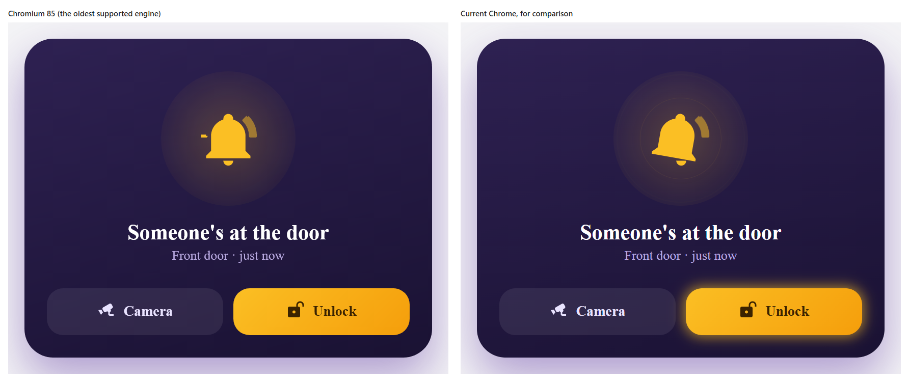
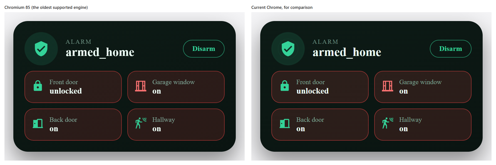

# Old engine check

This page records how two animated cards look on the oldest browser engine Magic Card supports: Chromium 85.0.4183.0, the engine of Android System WebView 85. It was checked on a desktop copy of that engine, not on a tablet, so it shows what the engine can draw. For the loading measurements, see [Older Android tablets](README.md).

Each screenshot puts Chromium 85 on the left and a current Chrome on the right. The icons and fonts differ from what Home Assistant shows, because the check runs outside Home Assistant.

Each CSS feature is marked:

- **Works**: Chromium 85 draws it as intended.
- **Broken**: Chromium 85 ignores the feature, and the effect is missing or looks wrong.

## Doorbell card

The Doorbell card (gallery card 41) swings a bell, draws sound waves, pulses a glow around the Unlock button and ripples rings behind the bell. The rings sit in a ripple layer.

| CSS feature | Used for | First in Chromium | Result on 85 |
| --- | --- | --- | --- |
| Keyframe animations, `calc()` and `var()` | Every animation on the card | Long before 85 | Works |
| `opacity`, `stroke-dashoffset` and `fill-opacity` in keyframes | Sound waves drawing on and fading out | Long before 85 | Works |
| `transform-box: view-box` | Keeps the bell's pivot point right | Before 85 | Works |
| `rotate` and `translate` as their own properties, in keyframes | Bell swing and clapper shake | 104 | Broken: the bell and clapper stay still |
| `color-mix()` in keyframes | Glow pulse around the Unlock button | 111 | Broken: no glow |
| `inset`, `aspect-ratio`, `container-type` and container units such as `cqmin` | Size of the ripple layer and its rings | `inset` 87, `aspect-ratio` 88, `container-type` and container units 105 | Broken: the ripple layer has no size and the rings shrink to 3 px dots |
| `scale` as its own property, in keyframes | Rings growing outwards | 104 | Broken: the rings only fade |
| `animation-fill-mode: backwards` with an opacity keyframe | The 200 ms fade-in of a ripple layer | Before 85 | Works, but the layer has no size, so there is nothing to see |
| `prefers-reduced-motion` | Hides the ripple layer and its rings | Before 85 | Works |
| The `:has()` selector | Icon animations on modules without an animated icon | 105 | Broken: the engine skips the rule. This card does not need it |

None of these features has a fallback today, so every "Broken" row shows less than the other engines do. The sound waves still draw on, so the card reads as ringing, but the bell does not swing.

## Security card

The Security card (gallery card 9) shows a rippling shield and pulses tiles when a door or window is open. It is the lowest gallery card that has a ripple layer.

| CSS feature | Used for | First in Chromium | Result on 85 |
| --- | --- | --- | --- |
| `opacity` with `calc()` and `var()` in keyframes | Pulsing fade on a tile | Long before 85 | Works |
| `inset`, `aspect-ratio`, `container-type` and container units | Size of the ripple layer and its rings | `inset` 87, `aspect-ratio` 88, `container-type` and container units 105 | Broken: the ripple layer has no size, so no rings show |
| `scale` as its own property, in keyframes | Rings growing outwards | 104 | Broken: the rings only fade |
| `animation-fill-mode: backwards` with an opacity keyframe | The 200 ms fade-in of a ripple layer | Before 85 | Works, but the layer has no size, so there is nothing to see |
| `prefers-reduced-motion` | Hides the ripple layer and its rings | Before 85 | Works |

## What this means

On Chromium 85 the ripple layers do not show, with or without the fade-in. A card that only uses sound waves and pulsing fades looks right. A card that relies on the swing, the glow or the rings looks flatter.
